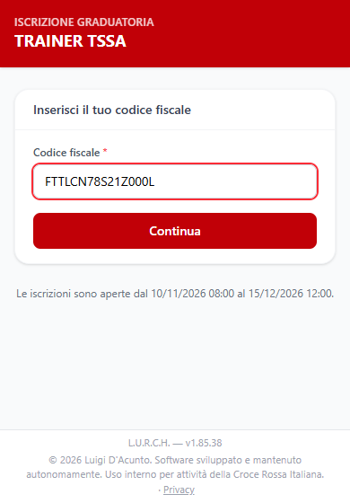
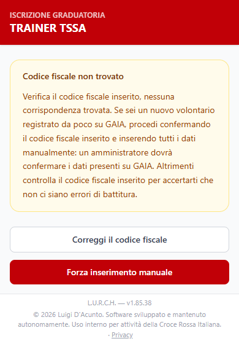
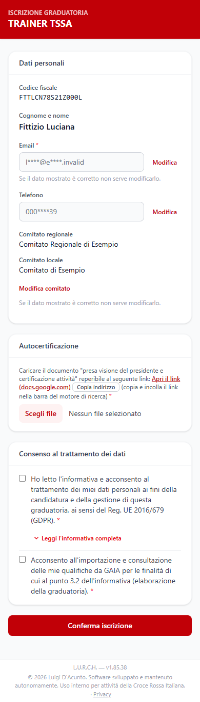
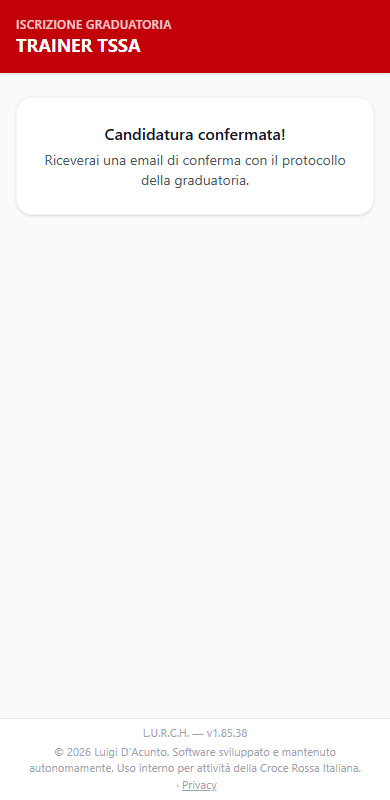

# Candidatura a una graduatoria

> **A chi serve:** volontari che vogliono partecipare a un corso con posti limitati; agli organizzatori, per sapere cosa compila chi si candida.

Per i corsi a numero chiuso gli organizzatori aprono una **graduatoria** e diffondono il suo link, uguale per tutti ([Graduatorie](../01-pannello/02-gestione-operativa/04-graduatorie/01-elenco-e-creazione.md)). Chi si candida compila un modulo; alla chiusura LURCH calcola la classifica in base ai criteri della graduatoria.

Il link funziona solo tra **apertura** e **chiusura** delle iscrizioni. Prima mostra la data di apertura, dopo la data in cui si sono chiuse.

## 1. Il codice fiscale

Si scrive il **codice fiscale** e si preme **Continua**. In fondo alla pagina sono indicate le date di apertura e chiusura.

<!-- screenshot: route=/graduatoria/{codice} · v1.85.38-dev · 2026-11-19 · codice fiscale di un socio di prova -->

- **Socio trovato**: il modulo si apre con i dati dell'archivio dei soci.
- **Codice fiscale non trovato**: la pagina invita a controllarlo. **Correggi il codice fiscale** torna indietro. **Forza inserimento manuale** serve a chi è diventato volontario da poco e non è ancora nell'archivio: nome, cognome, contatti e comitato si scrivono a mano, e la segreteria verifica i dati su GAIA prima di confermare la candidatura.

<!-- screenshot: route=/graduatoria/{codice}/completa · v1.85.38-dev · 2026-11-19 · codice fiscale sconosciuto -->

Lo stesso codice fiscale non può candidarsi due volte alla stessa graduatoria.

## 2. Il modulo

<!-- screenshot: route=/graduatoria/{codice}/completa · v1.85.38-dev · 2026-11-19 · comitati di esempio -->

- **Dati personali**: email e telefono compaiono in parte nascosti (per esempio `l****@e****.invalid`), perché chiunque conosca un codice fiscale potrebbe aprire il modulo. Se sono giusti si lasciano così; **Modifica** permette di scriverne di nuovi. L'email nuova vale solo dopo la [verifica](05-verifica-email.md). **Modifica comitato** cambia il comitato.
- Le sezioni successive dipendono dai [criteri della graduatoria](../01-pannello/02-gestione-operativa/04-graduatorie/02-criteri-di-selezione.md):
  - **Titolo di studio**: si dichiara di avere il diploma e di averlo caricato su GAIA;
  - **Autocertificazione**: si allega un PDF; il testo spiega che cosa autocertificare e, se contiene un indirizzo web, mostra **Apri il link** e **Copia indirizzo**;
  - **Attestazione del Presidente**: facoltativa, dà punti in più se la segreteria la verifica.
- **Consensi**: trattamento dei dati per la graduatoria e lettura delle qualifiche da GAIA, entrambi obbligatori.

**Conferma iscrizione** invia la candidatura.

## 3. La conferma

<!-- screenshot: route=/graduatoria/{codice}/grazie · v1.85.38-dev · 2026-11-19 -->

- **Socio trovato**: la candidatura è **confermata** subito e arriva un'email con il protocollo della graduatoria.
- **Inserimento manuale**: la candidatura resta **in attesa** finché la segreteria non verifica i dati.

Se l'email è nuova o mai verificata, la stessa pagina chiede di confermarla con il codice ricevuto ([Verifica dell'email](05-verifica-email.md)). L'esito della selezione arriva dagli organizzatori dopo la chiusura della graduatoria.
