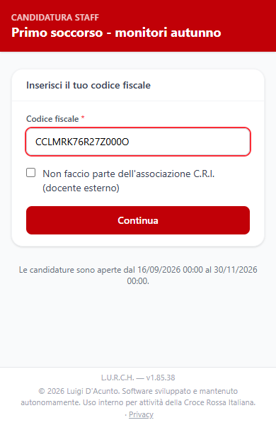
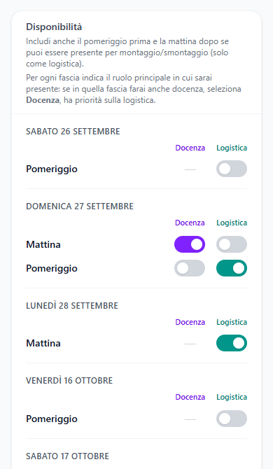
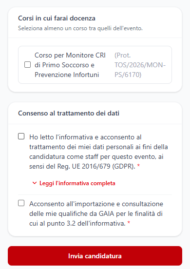
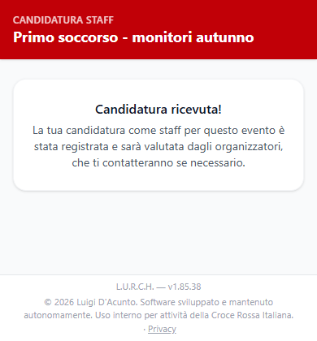

# Candidatura allo staff

> **A chi serve:** chi si offre come docente o logistica per un evento; agli organizzatori, per sapere cosa compila chi si candida.

Per alcuni eventi lo staff si raccoglie con un link aperto a tutti: chi vuole dare una mano si candida, e gli organizzatori scelgono chi confermare ([Candidature staff](../01-pannello/02-gestione-operativa/01-eventi/04-candidature-staff.md)). La candidatura **non è una conferma**: si entra nello staff solo quando un organizzatore la accetta. A quel punto arriva il [form dello staff](02-preregistrazione-staff.md).

Il link funziona solo tra le date di apertura e chiusura delle candidature; fuori da queste date, o se l'evento non raccoglie candidature, lo dice.

## 1. Il codice fiscale

<!-- screenshot: route=/candidatura-staff/{uuid} · v1.85.38-dev · 2026-11-19 · codice fiscale di un socio di prova -->

Si scrive il **codice fiscale** e si preme **Continua**:

- **Socio trovato**: il modulo si apre con i dati dell'archivio, come per le [graduatorie](03-candidatura-graduatoria.md#2-il-modulo).
- **Non faccio parte dell'associazione C.R.I. (docente esterno)**: chi non è socio spunta questa casella prima di continuare. Nome, cognome e contatti si scrivono a mano, e non si chiede il consenso alla lettura delle qualifiche da GAIA.
- **Codice fiscale non trovato** (senza la casella): come per le graduatorie, si può correggere o forzare l'inserimento manuale.

Lo stesso codice fiscale si candida una volta sola per evento.

## 2. Disponibilità e corsi

<!-- screenshot: route=/candidatura-staff/{uuid}/completa · v1.85.38-dev · 2026-11-19 · alcune fasce scelte -->

Come nel form dello staff, ogni giorno è diviso in mattina e pomeriggio e per ogni fascia si sceglie **Docenza** o **Logistica**. Docenza ha la precedenza: se in una fascia si fa anche docenza, si sceglie Docenza. Il pomeriggio del giorno prima e la mattina del giorno dopo sono riservati alla logistica (montaggio e smontaggio).

Scegliendo almeno una fascia di **Docenza** compare **Corsi in cui farai docenza**: si spunta almeno uno dei corsi dell'evento.

<!-- screenshot: route=/candidatura-staff/{uuid}/completa · v1.85.38-dev · 2026-11-19 · una fascia di docenza scelta -->

Seguono i consensi al trattamento dei dati e alla lettura delle qualifiche da GAIA. **Invia candidatura** la registra.

## 3. La conferma

<!-- screenshot: route=/candidatura-staff/{uuid}/grazie · v1.85.38-dev · 2026-11-19 -->

La pagina dice che la candidatura è stata **ricevuta** e sarà valutata dagli organizzatori, che contattano il candidato se serve. Non arriva un'email di esito: chi viene confermato riceve il link al form dello staff. Se l'email è nuova o mai verificata, la pagina chiede anche di [confermarla](05-verifica-email.md).
