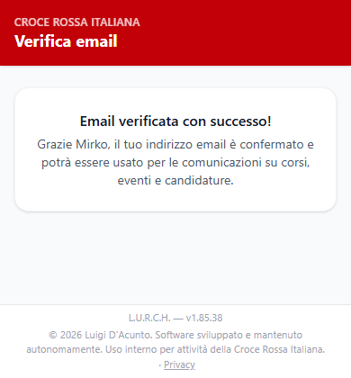

# Verifica dell'email

> **A chi serve:** chi ha compilato un modulo pubblico con un'email nuova o mai verificata.

LURCH invia le comunicazioni di corsi ed eventi all'email del socio. Per essere sicuri che l'indirizzo funzioni, e che sia davvero suo, lo verifica **una volta**. Succede dopo l'invio di uno di questi moduli:

- [preregistrazione del corsista](01-preregistrazione-corsista.md) o [dello staff](02-preregistrazione-staff.md), anche dall'app;
- [candidatura a una graduatoria](03-candidatura-graduatoria.md) o [allo staff](04-candidatura-staff.md).

La verifica parte quando l'email scritta nel modulo è **nuova** (è stata cambiata con **Modifica**) oppure quando l'email del socio **non è mai stata verificata**.

## Come si verifica

Arriva un'email con **un link e un codice di 6 cifre**. Basta una delle due cose:

- **il link**: si apre e mostra «Email verificata con successo!»;
- **il codice**: si scrive nel riquadro **Conferma il tuo indirizzo email** della pagina di conferma del modulo e si preme **Verifica**.

<!-- screenshot: route=/verifica-email/{token} · v1.85.38-dev · 2026-11-19 · testo aggiornato ricostruito a video -->

Link e codice valgono **30 minuti**; dopo 5 codici sbagliati la verifica si blocca per 30 minuti. Un link scaduto o già usato mostra **Link non valido o scaduto** oppure **Email già verificata**. Se l'email non arriva entro la giornata, conviene guardare nello spam.

## Perché l'email nuova non sostituisce subito la vecchia

I moduli pubblici si aprono con un link o con un codice fiscale, senza password. Se un'email nuova valesse subito, chi conosce il codice fiscale di un socio potrebbe dirottare le sue comunicazioni. Per questo l'indirizzo nuovo resta **in attesa** e prende il posto del vecchio solo dopo la verifica. Fino ad allora le comunicazioni continuano ad arrivare al vecchio indirizzo.
