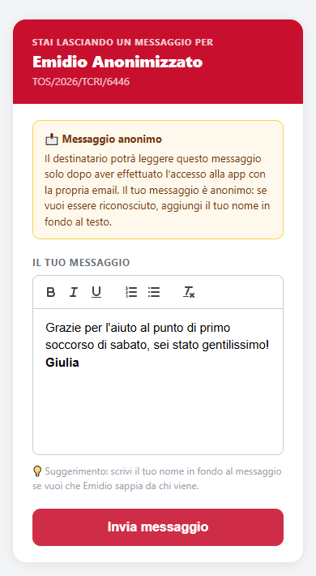
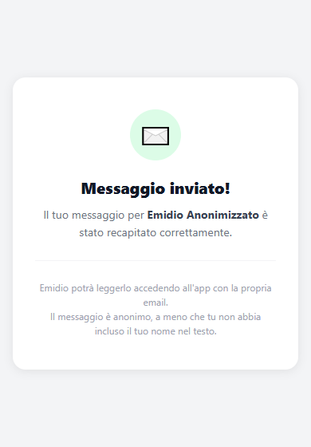
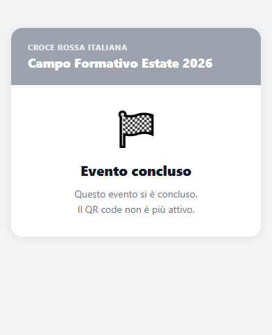

# Badge e messaggi

> **A chi serve:** partecipanti e staff di un evento, per sapere a cosa serve il loro codice QR; chiunque inquadri il QR di un partecipante.

Ogni partecipante e ogni membro dello staff ha un **codice QR personale** per quell'evento ([Partecipanti e badge](../01-pannello/02-gestione-operativa/01-eventi/05-partecipanti-e-badge.md)). Il QR non contiene dati personali: porta a una pagina di LURCH.

## Il QR per il check-in

Alcuni eventi registrano chi entra e chi esce con il QR; altri no. Dipende da come la segreteria organizza l'evento, e la segreteria dice anche in che forma arriva il QR:

- **stampato sul badge** consegnato all'arrivo o prima dell'evento;
- **per email**, come immagine dentro la comunicazione informativa dell'evento: in quel caso va tenuto a portata di mano sul telefono, oppure stampato.

All'ingresso il QR si mostra alla **segreteria**, che lo inquadra e registra l'entrata. Al primo ingresso la segreteria controlla con la persona i dati dichiarati nel form di preregistrazione (pasti, pernottamenti, allergie) e li corregge se è cambiato qualcosa. Chi ha dimenticato badge o email viene cercato per codice fiscale.

La scheda di check-in si apre solo agli operatori della segreteria collegati al pannello e abilitati per quell'evento ([Presenze live](../01-pannello/02-gestione-operativa/01-eventi/06-presenze-live.md#registrare-ingressi-e-uscite)). Chiunque altro inquadri il QR vede la pagina per lasciare un messaggio, descritta qui sotto.

Il QR resta attivo fino alla fine del giorno successivo all'ultimo giorno dell'evento; poi mostra **Evento concluso**.

## Lasciare un messaggio

Si inquadra il QR con la fotocamera del telefono e si apre il link. La pagina dice a chi si sta scrivendo e ha un piccolo editor con grassetto, corsivo, sottolineato ed elenchi.

<!-- screenshot: route=/badge/{evento}/{token} · v1.85.38-dev · 2026-11-19 · messaggio di esempio -->

Il messaggio è **anonimo**: chi vuole farsi riconoscere scrive il proprio nome in fondo al testo. **Invia messaggio** lo recapita, e il destinatario lo legge nell'[app dei soci](../02-app-soci/04-messaggi.md). Link, immagini e altri contenuti vengono tolti prima del salvataggio.

<!-- screenshot: route=/badge/{evento}/{token}/messaggio · v1.85.38-dev · 2026-11-19 -->

<!-- screenshot: route=/badge/{evento}/{token} · v1.85.38-dev · 2026-11-19 · evento concluso -->

