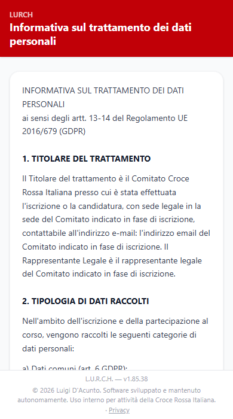

# Privacy e cookie

> **A chi serve:** chiunque usi i moduli pubblici o l'app; agli amministratori, per sapere da dove arriva il testo dell'informativa.

## L'informativa

Ogni pagina pubblica ha in fondo il link **Privacy**, che apre l'informativa sul trattamento dei dati personali. La stessa informativa si apre da **Leggi l'informativa completa** nei consensi dei moduli.

<!-- screenshot: route=/privacy · v1.85.38-dev · 2026-11-19 -->

Il testo **non è scritto nel programma**: viene dai [Template privacy](../01-pannello/04-impostazioni/02-template-privacy.md) del pannello. Ne esiste uno generale; ogni regione può avere il proprio e ogni evento può sostituirlo con un testo suo. I dati del comitato (nome, sede, email) si inseriscono da soli. La pagina `/privacy` mostra il testo generale, perché non riguarda un evento preciso.

## Cookie e dati di navigazione

In fondo all'informativa una sezione fissa spiega i cookie. LURCH usa **solo cookie tecnici**, quindi non chiede il consenso e non mostra banner:

- **cookie di sessione**: mantiene l'accesso e lo stato della navigazione;
- **XSRF-TOKEN**: protegge i moduli da invii fraudolenti;
- **app_remember**: solo nell'[app dei soci](../02-app-soci/01-installazione-e-accesso.md), ricorda l'accesso sul dispositivo per 90 giorni.

Non ci sono statistiche, pubblicità o contenuti di altri siti: script, stili e caratteri arrivano tutti dal server di LURCH. I collegamenti esterni, come le mappe, si aprono solo quando si toccano.

## Il piè di pagina

In fondo alle pagine pubbliche ci sono la versione di LURCH, il copyright e il link **Privacy**. Sul telefono le righe vanno a capo. Le versioni del server (PHP, Laravel) e l'ambiente compaiono solo fuori dalla produzione, per non dare informazioni utili a chi cerca falle note.
