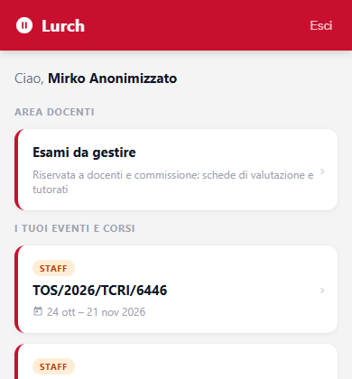
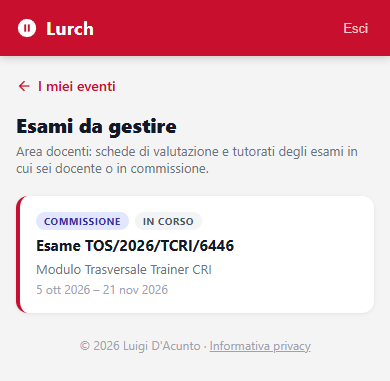
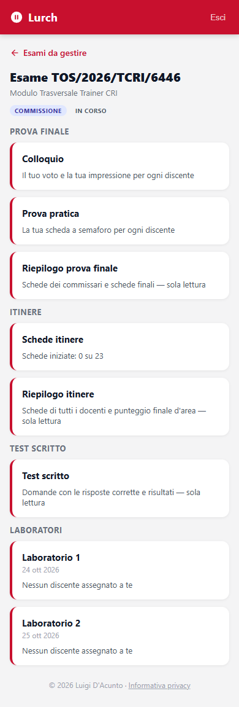
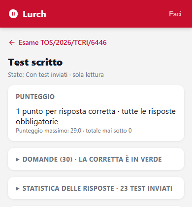
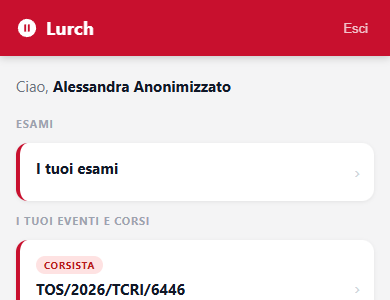
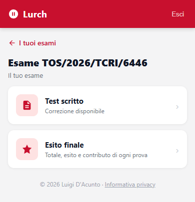

# L'esame nell'app

> **A chi serve:** docenti, commissioni d'esame e discenti.

Nell'[app dei soci](../../02-app-soci/README.md) l'esame si trova dalla home. Cosa si vede dipende dal ruolo: chi valuta trova le sue schede, il discente trova il suo test e, quando viene pubblicato, il suo esito.

Un esame in **bozza** non compare a nessuno: compare dopo che il direttore o un amministratore lo ha attivato.

## Docenti e commissione

Nella home, sopra gli eventi, la sezione **Area docenti** ha la voce **Esami da gestire**.

<!-- screenshot: route=/app · v1.86.2 · 2026-11-19 · larghezza telefono, direttore del corso -->

Si apre l'elenco degli esami in cui si è docenti o in commissione. Ogni esame mostra il titolo, il corso, le date del corso e due etichette: il ruolo (**Commissione** o **Docente**) e lo stato (**In corso** o **Chiuso**).

<!-- screenshot: route=/app/esami · v1.86.2 · 2026-11-19 · larghezza telefono -->

Aprendo un esame si trovano, a seconda del ruolo:

<!-- screenshot: route=/app/esami/1 · v1.86.2 · 2026-11-19 · larghezza telefono, direttore con la prova finale aperta -->

| Sezione | Cosa contiene | Chi la vede |
|---|---|---|
| **Tutoraggio** | **I miei tutorati**: l'andamento dei discenti che si seguono, in sola lettura | i tutor |
| **Itinere** | **Schede itinere**, con il numero di schede iniziate; **Riepilogo itinere**, in sola lettura | le schede: tutti i docenti, compreso il direttore; il riepilogo: la commissione |
| **Prova finale** | **Colloquio** e **Prova pratica**: le proprie schede personali; **Riepilogo prova finale**, in sola lettura | le schede: direttore e docenti in commissione, quando la prova finale è aperta; il riepilogo: la commissione |
| **Test scritto** | Le domande con le risposte corrette e la statistica delle risposte (due riquadri chiusi di default), poi i risultati dei discenti, in sola lettura | la commissione |
| **Laboratori** | Un riquadro per laboratorio, con la data e quante schede si sono inviate sui propri discenti | tutti; chi non ha discenti in quel laboratorio legge «Nessun discente assegnato a te» |

Quando la prova finale è aperta, la sezione **Prova finale** passa in cima alla pagina. Se viene richiusa, chi ha già scritto delle schede le ritrova in sola lettura.

Nella pagina **Test scritto** la statistica ha le stesse evidenze del pannello ([Statistica delle risposte](../03-svolgimento-e-chiusura/02-test-scritto.md#statistica-delle-risposte)); il PDF si scarica solo dal pannello. I riquadri delle domande e della statistica restano chiusi a ogni apertura e aggiornamento della pagina: chi la ricarica durante il test per vedere chi ha inviato non mette in vista le risposte corrette.

<!-- screenshot: route=/app/esami/1/test/anteprima · v1.86.4 · 2026-11-22 · larghezza telefono, docente di prova in commissione, riquadri chiusi -->

Le singole schede sono descritte nel capitolo del modello: per gli esami TCRI vedi [Modello TCRI](../04-modello-tcri/README.md).

## Discenti

Il discente trova nella home la sezione **Esami** con la voce **I tuoi esami**, ma solo da quando il direttore ha avviato il test scritto per lui.

<!-- screenshot: route=/app · v1.86.2 · 2026-11-19 · larghezza telefono, discente -->

Nella pagina del suo esame ci sono:

<!-- screenshot: route=/app/esami/1 · v1.86.2 · 2026-11-19 · larghezza telefono, discente con correzione ed esito pubblicati -->

- **Test scritto**, con l'indicazione **Da compilare**, poi **Inviato** (le risposte si rivedono in sola lettura) e infine **Correzione disponibile**, quando il direttore pubblica i risultati ([Il test per il discente](../03-svolgimento-e-chiusura/03-il-test-per-il-discente.md));
- **Esito finale**, solo quando il direttore lo ha pubblicato: il totale, l'esito e il contributo di ogni prova. Fino ad allora la pagina dice che l'esito comparirà lì quando il direttore lo pubblicherà ([Esito e pubblicazione](../03-svolgimento-e-chiusura/05-esito-e-pubblicazione.md)).

Il discente non vede mai le schede dei docenti né le valutazioni delle singole prove prima della pubblicazione.
