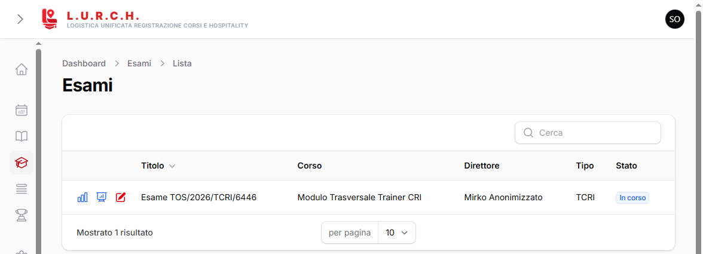

# Creare l'esame

> **A chi serve:** direttori dei corsi e amministratori.

Un esame si crea sempre **dal suo corso**: ogni corso ne ha al massimo uno. Non c'è un pulsante «Nuovo» nell'elenco degli esami.

## Prima di creare: cosa serve sul corso

Nel modulo del corso ([Creare e modificare un corso](../../01-pannello/02-gestione-operativa/02-corsi/02-creare-e-modificare.md)) servono:

- il **direttore del corso scelto tra i soci**, non solo scritto a mano;
- il **tipo di corso** dal catalogo: è quello che decide il modello d'esame. Oggi esiste solo il modello **TCRI**;
- i **docenti**, se ci sono (possono essere anche zero), e il **presidente o delegato**, se c'è.

Docenti e presidente si possono aggiungere anche dopo, finché l'esame è aperto.

## Creare l'esame

Da **Gestione corso**, il menu **Azioni** ha la voce **Crea esame**. La vedono il direttore del corso, gli amministratori del territorio del corso e il superadmin.

Se manca qualcosa la voce è spenta e, passando il mouse, dice cosa manca: il direttore scelto tra i soci, il tipo di corso oppure un modello d'esame per quel tipo.

<!-- screenshot: route=/admin/corsi/28/gestione · v1.86.2 · 2026-11-19 · menu Azioni, suggerimento su «Crea esame» -->

**Crea esame** chiede due dati:

| Campo | Cosa contiene |
|---|---|
| Titolo | Proposto come «Esame» seguito dal protocollo del corso; si può cambiare |
| LAP (soglia di idoneità, %) | La percentuale minima del punteggio finale per essere idonei. Vuoto vale 60. Si può cambiare fino alla chiusura dell'esame |

Con **Crea** l'esame nasce **in bozza**, con il **Laboratorio 1** già pronto, e si apre la sua [Panoramica](02-panoramica-e-commissione.md). Da quel momento la voce del corso diventa **Vai all'esame**.

## L'elenco Esami

Da **Gestione operativa → Esami** si vedono gli esami a cui si ha accesso ([Ruoli e accessi](../01-come-funziona/01-ruoli-e-accessi.md)).

<!-- screenshot: route=/admin/esami · v1.86.2 · 2026-11-19 -->

| Colonna | Cosa mostra |
|---|---|
| Titolo | Il titolo dell'esame |
| Corso | Il nome del corso |
| Direttore | Il direttore del corso |
| Tipo | Il tipo d'esame, cioè il modello (TCRI) |
| Stato | **Bozza**, **In corso** o **Chiuso** |

Le icone all'inizio della riga:

- il **grafico a barre** apre la [Panoramica](02-panoramica-e-commissione.md), la parte di gestione (solo per chi gestisce l'esame);
- la **lavagna** apre le [Valutazioni](../03-svolgimento-e-chiusura/01-valutazioni.md), dopo l'attivazione;
- la **matita** apre la pagina di modifica (titolo e LAP);
- i **tre puntini** contengono **Elimina**, solo per un esame in bozza e senza dati.

Cliccando sulla riga, chi gestisce l'esame apre la Panoramica; chi lo legge soltanto (presidente o delegato, docenti in commissione) apre le Valutazioni in sola lettura.
