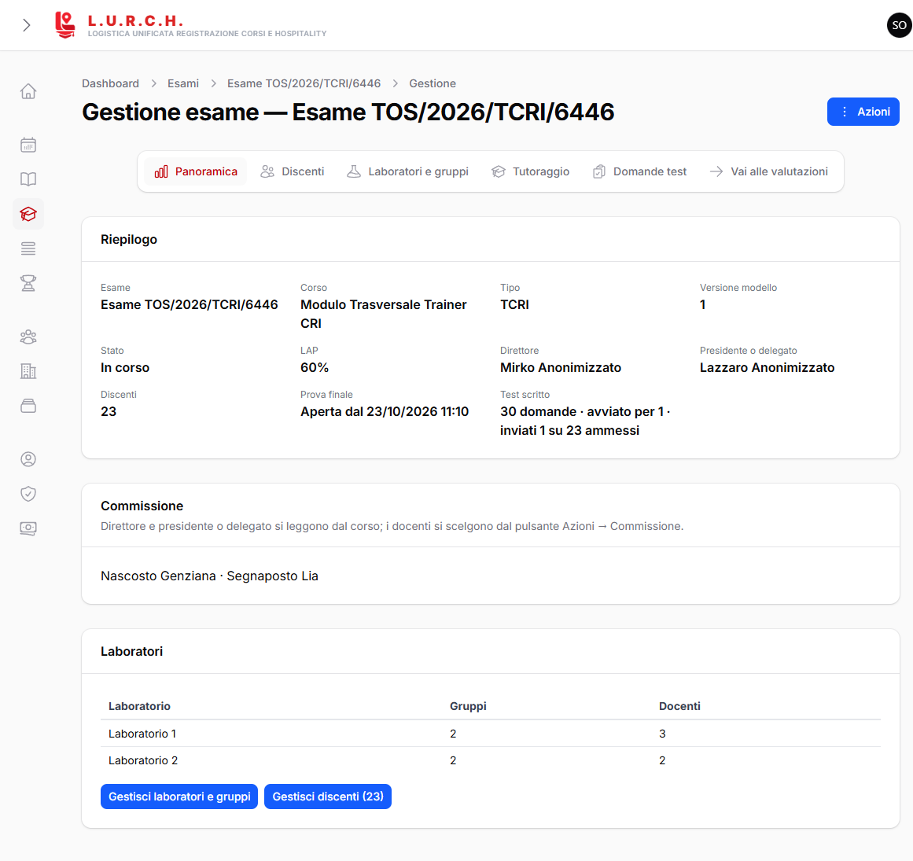
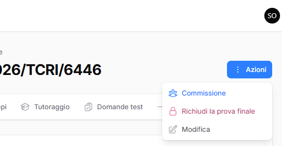
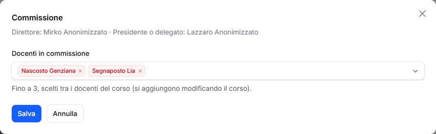

# Panoramica e commissione

> **A chi serve:** direttori dei corsi e amministratori.

Aprendo un esame si arriva nella sezione **Gestione**, quella della preparazione. In alto c'è la barra delle sue pagine: **Panoramica**, **Discenti**, **Laboratori e gruppi**, **Tutoraggio**, **Domande test**. In fondo alla barra, **Vai alle valutazioni** porta all'altra sezione, quella dello svolgimento ([Valutazioni](../03-svolgimento-e-chiusura/01-valutazioni.md)).

La sezione Gestione si può modificare finché l'esame non è chiuso.

## La Panoramica

<!-- screenshot: route=/admin/esami/1/gestione · v1.86.2 · 2026-11-19 -->

Il riquadro **Riepilogo** riassume l'esame:

| Voce | Cosa mostra |
|---|---|
| Esame, Corso | Titolo dell'esame e nome del corso |
| Tipo, Versione modello | Il modello d'esame e la sua versione |
| Stato | Bozza, In corso o Chiuso ([Ciclo di vita](../01-come-funziona/02-ciclo-di-vita.md)) |
| LAP | La soglia di idoneità in percentuale |
| Direttore, Presidente o delegato | Letti dal corso |
| Discenti | Gli iscritti al corso, esclusi i ritirati |
| Prova finale | Da quando è aperta, oppure «Non aperta» |
| Test scritto | Numero di domande, per quanti discenti è stato avviato e quanti l'hanno inviato |

Sotto, il riquadro **Commissione** elenca i docenti in commissione. Se non ce n'è nessuno lo segnala: con zero docenti in commissione il direttore compila le schede come gli altri docenti.

Il riquadro **Laboratori** elenca i laboratori con il numero di gruppi e di docenti assegnati. I pulsanti **Gestisci laboratori e gruppi** e **Gestisci discenti** portano alle pagine relative.

## Il menu Azioni

<!-- screenshot: route=/admin/esami/1/gestione · v1.86.2 · 2026-11-19 · menu Azioni aperto, esame in corso -->

| Voce | Cosa fa | Chi la vede |
|---|---|---|
| **Commissione** | Sceglie i docenti in commissione (vedi sotto) | amministratori del territorio e superadmin |
| **Attiva esame** | Passa l'esame da bozza a in corso. Chiede conferma: da quel momento il modello d'esame resta quello attuale. Spenta, con il motivo, se manca il direttore collegato a un socio o un laboratorio | chi gestisce l'esame, solo in bozza |
| **Apri la prova finale** / **Richiudi la prova finale** | Apre o blocca le schede personali della prova finale per direttore e docenti in commissione ([Ciclo di vita](../01-come-funziona/02-ciclo-di-vita.md#prova-finale-aperta-o-chiusa)) | chi gestisce l'esame, solo in corso |
| **Modifica** | Apre la pagina di modifica: titolo e LAP. Tipo, versione del modello, stato e direttore si leggono soltanto | chi gestisce l'esame, finché non è chiuso |

Nella pagina di modifica, a esame in corso, c'è anche **Riporta in bozza**: serve solo se l'esame è stato attivato per errore ed è spento appena esiste una scheda, un test o un esito.

## La commissione

La commissione è formata da direttore, presidente o delegato (letti dal corso) e da **0 a 3 docenti del corso** scelti da un amministratore. Il direttore non la imposta.

<!-- screenshot: route=/admin/esami/1/gestione · v1.86.2 · 2026-11-19 · finestra Commissione -->

La finestra ricorda in alto chi sono direttore e presidente o delegato. Nel campo **Docenti in commissione** si scelgono fino a 3 nomi tra i docenti del corso; un docente che non compare va prima aggiunto nel modulo del corso. **Salva** registra la scelta, che si può cambiare fino alla chiusura dell'esame.

Cosa cambia per chi entra in commissione: [Ruoli e accessi](../01-come-funziona/01-ruoli-e-accessi.md).
