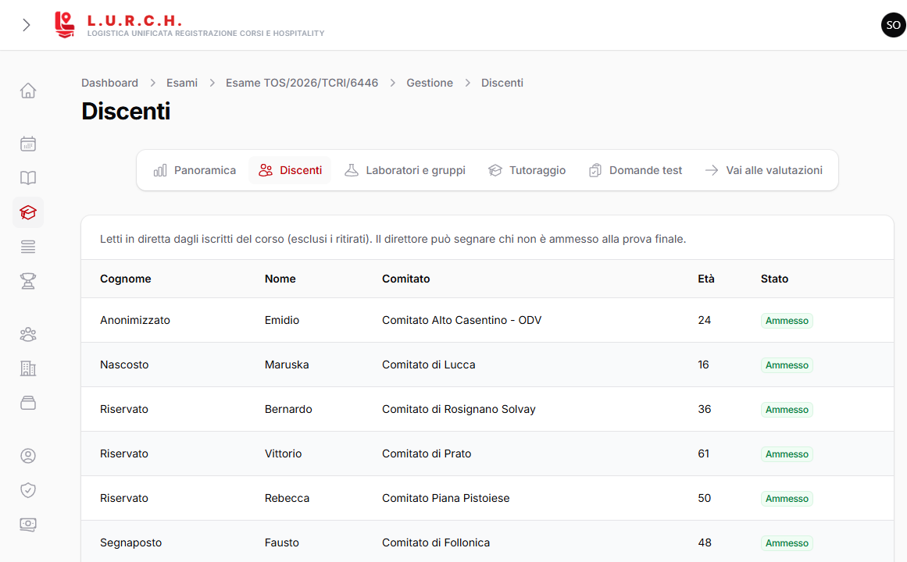

# Discenti

> **A chi serve:** direttori dei corsi e amministratori.

I discenti dell'esame **non si inseriscono a mano**: sono gli iscritti al corso, letti in diretta. Chi si iscrive o viene aggiunto al corso compare subito anche qui; chi si ritira dal corso sparisce dall'elenco.

<!-- screenshot: route=/admin/esami/1/gestione/discenti · v1.86.2 · 2026-11-19 -->

| Colonna | Cosa mostra |
|---|---|
| Cognome, Nome | Il discente |
| Comitato | Il suo comitato |
| Età | L'età compiuta alla data di fine del corso (la data compare passando il mouse) |
| Stato | **Ammesso** oppure **Non ammesso**; passando il mouse su «Non ammesso» si legge il motivo |

## Ritirati e non ammessi

Sono due casi diversi:

- **Ritirato** è uno stato del **corso**: si imposta dalla pagina degli iscritti ([Iscritti](../../01-pannello/02-gestione-operativa/02-corsi/04-iscritti.md)). Il discente sparisce dall'esame e non riceve più schede nuove; quelle già compilate restano registrate. Non ha esito.
- **Non ammesso** riguarda solo la **prova finale** e si segna qui. Il discente resta nelle schede del corso (laboratori, itinere), ma non fa la prova finale, non ha schede finali né punteggio, e nell'esito compare come «Non ammesso».

## Segnare un discente non ammesso

Lo fa **solo il direttore del corso**, a esame in corso, dai tre puntini rossi della riga: **Segna non ammesso**. Il **motivo** è obbligatorio (fino a 1000 caratteri) e resta nel pannello: non esce nei PDF né nei CSV.

La finestra di conferma dice cosa verrà nascosto: schede finali già inserite, il test già inviato (resta salvato ma non conta) oppure il test avviato, che il discente non vedrà più. **Non si cancella nulla.**

**Togli non ammesso** riporta il discente ammesso: schede e test già scritti tornano visibili e il motivo viene cancellato. Si può fare finché l'esame è in corso.

> Per gli amministratori le due voci non compaiono: la non ammissione è una decisione del direttore.
