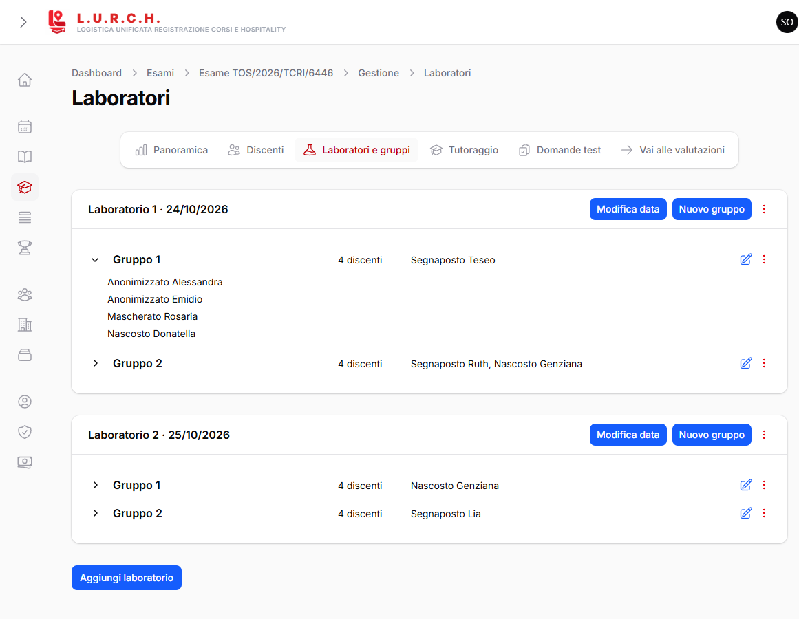
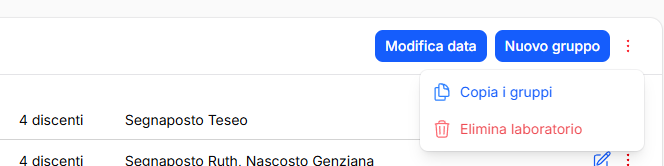
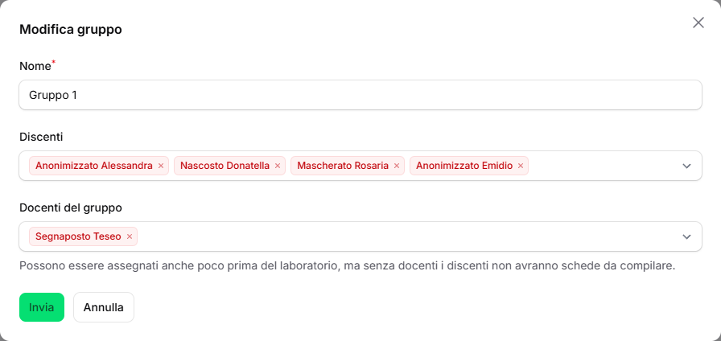

# Laboratori e gruppi

> **A chi serve:** direttori dei corsi e amministratori.

I **laboratori** sono le giornate in cui i docenti osservano i discenti al lavoro. In ogni laboratorio i discenti sono divisi in **gruppi**, ognuno con i suoi docenti: un docente compila le schede di laboratorio solo per i discenti dei suoi gruppi. Cosa contiene la scheda dipende dal modello (nel TCRI: [Laboratori a semaforo](../04-modello-tcri/02-laboratori-a-semaforo.md)).

Li gestisce chi gestisce l'esame (direttore, amministratori del territorio, superadmin), in bozza e in corso. A esame chiuso la pagina è in sola lettura.

<!-- screenshot: route=/admin/esami/1/gestione/laboratori · v1.86.2 · 2026-11-19 · Gruppo 1 del Laboratorio 1 aperto -->

Ogni laboratorio è un riquadro con il numero, la data e i suoi gruppi. Ogni gruppo mostra il nome, quanti discenti ha e i docenti assegnati; cliccando sulla riga si apre l'elenco dei discenti (un discente ritirato è segnato «(ritirato)»).

## Laboratori

- **Aggiungi laboratorio**, in fondo alla pagina, crea il laboratorio successivo; la data si può indicare subito o dopo.
- **Modifica data** cambia la data del laboratorio.
- Dai **tre puntini** del laboratorio: **Copia i gruppi** (vedi sotto) ed **Elimina laboratorio**, che elimina anche i suoi gruppi.

<!-- screenshot: route=/admin/esami/1/gestione/laboratori · v1.86.2 · 2026-11-19 · menu del laboratorio -->

Un laboratorio **non si elimina** se ha già schede registrate, né se è l'unico: un esame ha sempre almeno un laboratorio.

## Gruppi

**Nuovo gruppo** apre la finestra del gruppo; la **matita** della riga la apre in modifica.

<!-- screenshot: route=/admin/esami/1/gestione/laboratori · v1.86.2 · 2026-11-19 · finestra Modifica gruppo -->

| Campo | Cosa contiene |
|---|---|
| Nome | Il nome del gruppo |
| Discenti | I discenti del gruppo. Nello stesso laboratorio un discente sta in un solo gruppo |
| Docenti del gruppo | I docenti che compilano le schede di questi discenti, scelti tra i docenti del corso e il direttore |

I docenti si possono assegnare anche poco prima del laboratorio, ma senza docenti i discenti del gruppo non hanno schede da compilare. Spostare un docente o un discente non cancella le schede già compilate.

Dai tre puntini della riga, **Elimina gruppo** toglie il gruppo e le sue assegnazioni; le schede già compilate restano.

## Copiare i gruppi da un altro laboratorio

Se i gruppi si ripetono da un laboratorio all'altro, dai tre puntini del laboratorio di arrivo scegli **Copia i gruppi**, poi:

- **Copia dal**: il laboratorio di partenza;
- **Gruppi da copiare**: **Tutti i gruppi** oppure uno solo.

Vengono copiati il nome e i discenti (i ritirati no), **non i docenti**, che vanno assegnati dopo. Il laboratorio di arrivo può avere già dei gruppi; se però un discente finirebbe in due gruppi dello stesso laboratorio, non viene copiato nulla e il messaggio dice chi sono i discenti in conflitto.
