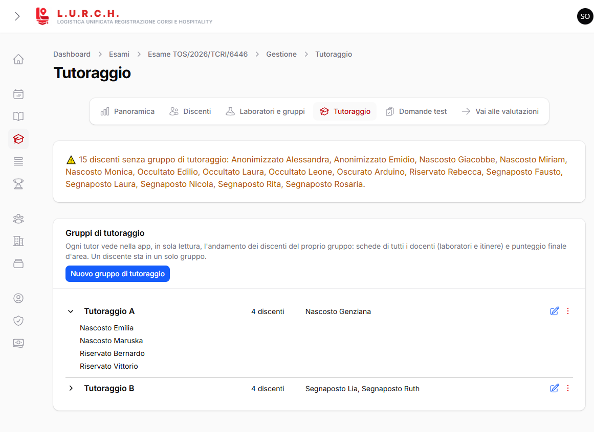
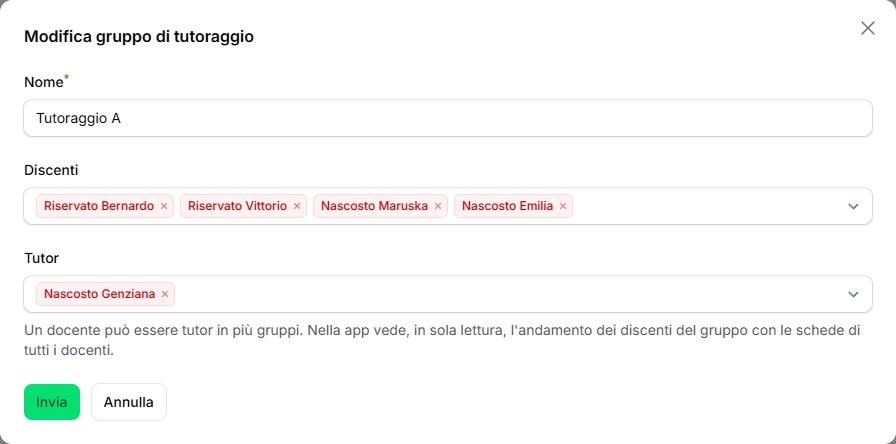

# Tutoraggio

> **A chi serve:** direttori dei corsi, amministratori e tutor.

Un **gruppo di tutoraggio** affida alcuni discenti a uno o più **tutor**, che li seguono per tutto il corso. A differenza dei gruppi dei laboratori, il tutoraggio non serve a compilare schede: dà al tutor la possibilità di **leggere** l'andamento dei suoi discenti, con le schede scritte da tutti i docenti.

I gruppi li gestisce chi gestisce l'esame (direttore, amministratori del territorio, superadmin), finché l'esame non è chiuso. Si possono creare anche a esame già in corso: il tutor vede subito anche le schede inserite prima.

<!-- screenshot: route=/admin/esami/1/gestione/tutoraggio · v1.86.2 · 2026-11-19 · due gruppi finti, Tutoraggio A aperto -->

In alto un avviso elenca i discenti che non sono ancora in nessun gruppo di tutoraggio. Ogni gruppo mostra il nome, quanti discenti ha e i tutor; cliccando sulla riga si apre l'elenco dei discenti.

## Creare e modificare un gruppo

**Nuovo gruppo di tutoraggio** apre la finestra del gruppo; la **matita** della riga la apre in modifica.

<!-- screenshot: route=/admin/esami/1/gestione/tutoraggio · v1.86.2 · 2026-11-19 · finestra Modifica gruppo di tutoraggio -->

| Campo | Cosa contiene |
|---|---|
| Nome | Il nome del gruppo |
| Discenti | I discenti seguiti. Un discente sta in un solo gruppo di tutoraggio |
| Tutor | Uno o più tutor, scelti tra i docenti del corso e il direttore. Un docente può essere tutor in più gruppi |

Dai tre puntini della riga, **Elimina gruppo di tutoraggio** toglie il gruppo e le sue assegnazioni. Schede e valutazioni non dipendono dal tutoraggio e restano tutte.

## Cosa vede il tutor

Nell'app, nella pagina dell'esame, il tutor trova la sezione **Tutoraggio** con **I miei tutorati** ([L'esame nell'app](../01-come-funziona/04-l-esame-nell-app.md)). Per i suoi discenti vede, **in sola lettura**:

- le schede di tutti i docenti durante il corso: nel modello TCRI le schede itinere e quelle dei laboratori già inviate (le bozze no);
- il punteggio finale delle aree, quando il direttore lo ha fissato;
- le note dei docenti su quei discenti.

Non vede le schede della prova finale, il test scritto né l'esito, e non può modificare le schede degli altri. Se un tutor viene tolto dai docenti del corso non vede più nulla. La pagina «I miei tutorati» è descritta nel capitolo del modello ([Itinere](../04-modello-tcri/03-itinere.md)).
