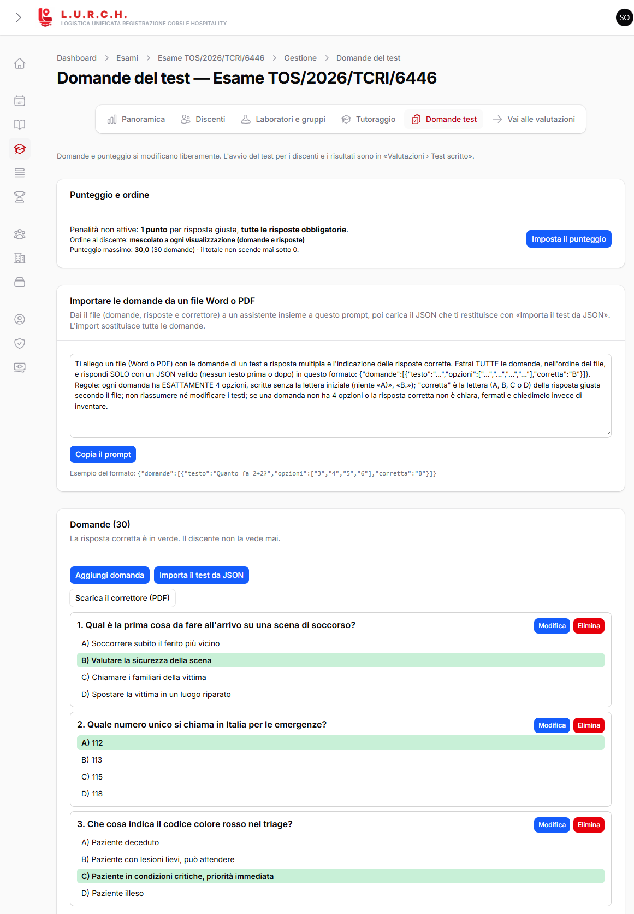
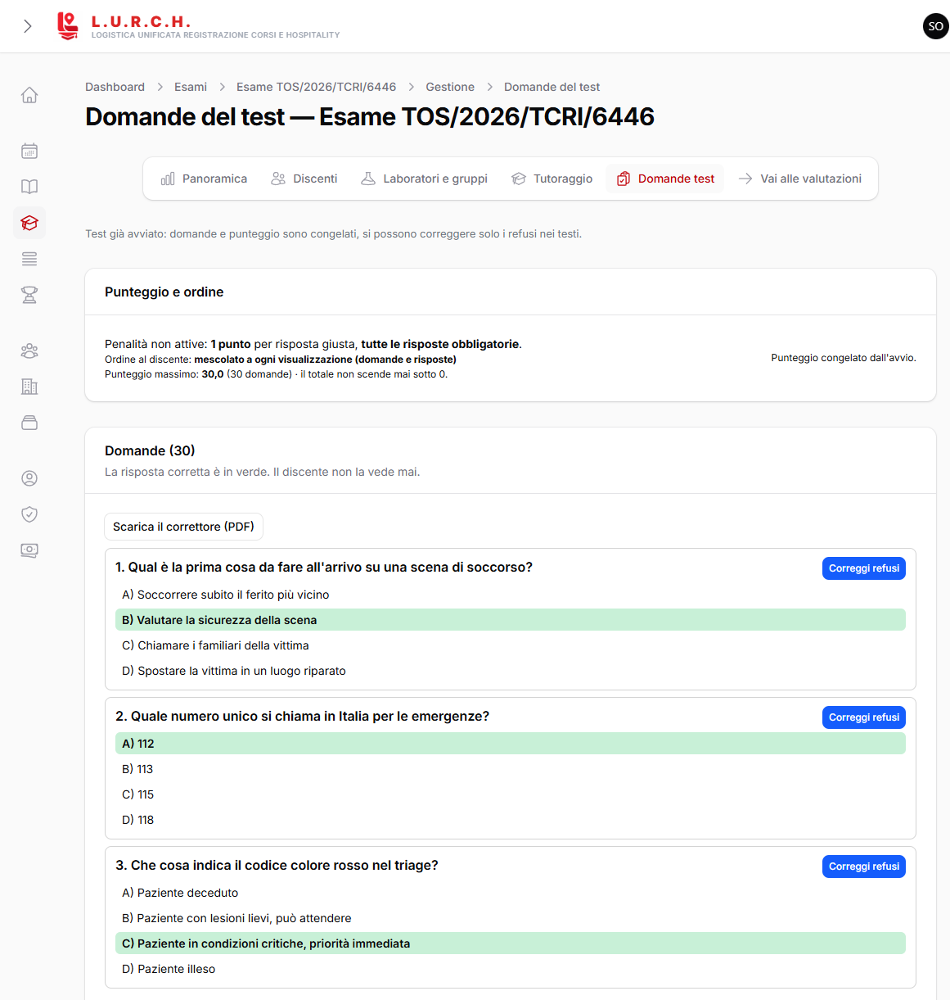

# Domande del test

> **A chi serve:** direttori dei corsi e amministratori.

Il **test scritto** è a risposta multipla: ogni domanda ha 4 risposte e una sola è corretta. Le domande e il punteggio si preparano in questa pagina; l'avvio del test ai discenti e i risultati sono nell'altra sezione ([Test scritto](../03-svolgimento-e-chiusura/02-test-scritto.md)).

Prepara il test chi gestisce l'esame (direttore, amministratori del territorio, superadmin), anche **prima di attivare l'esame**. Domande e punteggio si cambiano liberamente finché il test non è stato avviato a nessun discente.

<!-- screenshot: route=/admin/esami/1/gestione/domande-test · v1.86.2 · 2026-11-19 · stato «in bozza» ricostruito a video dal codice della pagina, riquadro dell'import aperto; domande d'esempio -->

## Punteggio e ordine

Il riquadro **Punteggio e ordine** riassume le regole; **Imposta il punteggio** le cambia:

- **Mescola domande e risposte**: ogni discente, a ogni visualizzazione, vede domande e risposte in ordine casuale. Se ricarica la pagina l'ordine cambia, ma le risposte già date restano. La correzione non dipende dalla posizione. Spento, il test segue l'ordine dato qui;
- **Attiva le penalità**: senza penalità vale 1 punto per risposta giusta e tutte le risposte sono obbligatorie. Con le penalità si indicano i **punti per risposta corretta**, i **punti sottratti per risposta sbagliata** e quelli **per risposta non data** (con la virgola, al massimo 1 decimale, almeno una penalità maggiore di zero); il discente può lasciare risposte vuote.

Il totale non scende mai sotto zero. Il riquadro mostra anche il **punteggio massimo** del test.

## Le domande

Il riquadro **Domande** elenca le domande con le 4 risposte; quella corretta è **in verde**. Il discente non la vede mai.

- **Aggiungi domanda** apre la finestra con il testo della domanda, le opzioni A, B, C e D e la **risposta corretta**; tutti i campi sono obbligatori.
- **Modifica** ed **Elimina**, su ogni domanda, la cambiano o la tolgono (le altre si rinumerano).
- **Scarica il correttore (PDF)** scarica tutte le domande con la risposta corretta, per la commissione. Non va mai dato ai discenti.

## Importare le domande da un file Word o PDF

Se il test esiste già in un documento, non serve ricopiarlo a mano. Il riquadro **Importare le domande da un file Word o PDF**, chiuso all'apertura della pagina (si apre cliccando sul titolo), contiene un **prompt** da dare a un assistente di intelligenza artificiale insieme al file (domande, risposte e correttore); **Copia il prompt** lo copia negli appunti. L'assistente restituisce un testo in formato JSON.

**Importa il test da JSON** carica quel testo, come file `.json` oppure incollato nella finestra:

- l'import **sostituisce tutte le domande** del test; il punteggio non cambia;
- se anche una sola domanda non è valida non cambia nulla, e il messaggio dice quali domande correggere.

Prima di avviare il test, controlla le domande importate con il correttore in verde: l'assistente può sbagliare.

## Dopo l'avvio

Appena il test viene avviato anche a un solo discente, domande e punteggio sono **congelati**: la pagina lo dice in alto e su ogni domanda resta solo **Correggi refusi**, che corregge il testo di domande e risposte ma non la risposta corretta. Import, aggiunta ed eliminazione non sono più possibili e il riquadro dell'import sparisce.

<!-- screenshot: route=/admin/esami/1/gestione/domande-test · v1.86.2 · 2026-11-19 · test già avviato; domande sostituite a video con domande d'esempio -->

