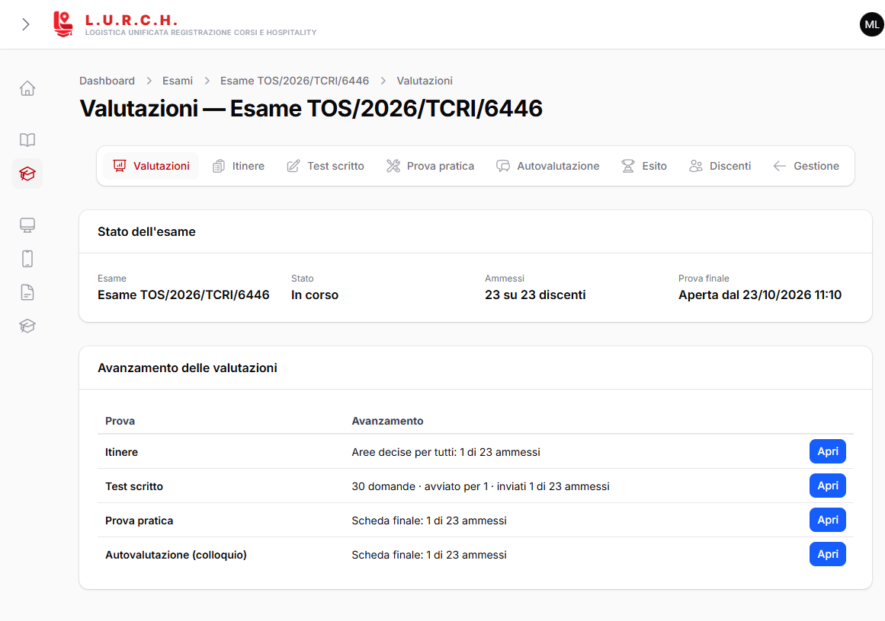

# Valutazioni

> **A chi serve:** direttori dei corsi, commissioni e amministratori.

Dopo **Attiva esame** l'esame ha una seconda sezione, **Valutazioni**, quella dello svolgimento. Ci si arriva da **Vai alle valutazioni**, in fondo alla barra della Gestione, oppure dall'icona a forma di lavagna nell'elenco Esami. In fondo alla barra delle Valutazioni, **Gestione** riporta alla preparazione.

La barra ha queste pagine:

| Pagina | Cosa contiene |
|---|---|
| **Valutazioni** | Lo stato dell'esame e l'avanzamento delle prove (questa pagina) |
| **Itinere**, **Prova pratica**, **Autovalutazione** | Le schede del modello: nel modello TCRI vedi [Itinere](../04-modello-tcri/03-itinere.md), [Prova pratica](../04-modello-tcri/05-prova-pratica.md), [Colloquio](../04-modello-tcri/04-colloquio.md) |
| **Test scritto** | Avvio del test ai discenti, risultati e pubblicazione ([Test scritto](02-test-scritto.md)) |
| **Esito** | Il punteggio finale di ogni discente, la chiusura e gli export ([Esito e pubblicazione](05-esito-e-pubblicazione.md), [Chiusura, riapertura ed export](06-chiusura-riapertura-export.md)) |
| **Discenti** | I punteggi di ogni discente, la proiezione e la pubblicazione dell'esito ([Riepilogo dei discenti](04-riepilogo-dei-discenti.md)) |

La sezione la vedono chi gestisce l'esame (direttore, amministratori del territorio, superadmin) e, in sola lettura, il presidente o delegato e i docenti in commissione. Gli altri docenti lavorano solo dall'app.

<!-- screenshot: route=/admin/esami/1/valutazioni · v1.86.2 · 2026-11-19 · come direttore del corso -->

Il riquadro **Stato dell'esame** mostra lo stato, quanti discenti sono ammessi alla prova finale e se la prova finale è aperta.

Il riquadro **Avanzamento delle valutazioni** dice, per ogni prova, quanti discenti ammessi hanno già il dato che conta per il calcolo:

- **Itinere**: per quanti il direttore ha fissato il punteggio di tutte le aree;
- **Test scritto**: quante domande, per quanti discenti è avviato e quanti l'hanno inviato;
- **Prova pratica** e **Autovalutazione (colloquio)**: per quanti c'è la scheda finale.

**Apri** porta alla pagina di quella prova. Quando tutte le righe arrivano al totale degli ammessi, l'esame si può chiudere ([Chiusura, riapertura ed export](06-chiusura-riapertura-export.md)).
