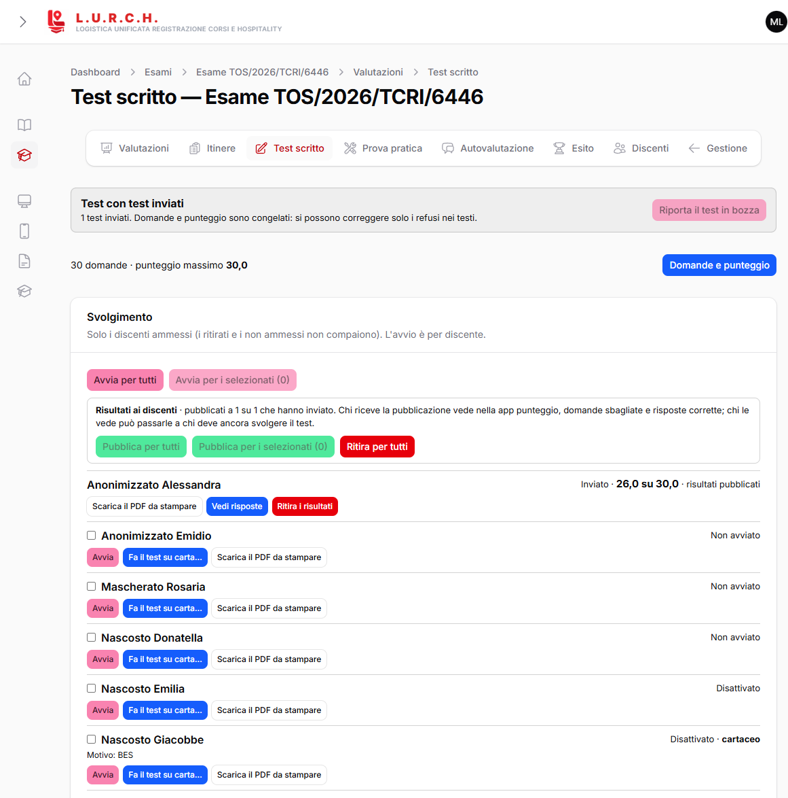
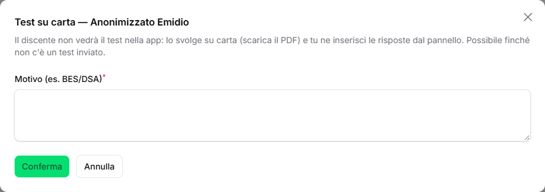

# Test scritto

> **A chi serve:** direttori dei corsi, commissioni e amministratori.

Da **Valutazioni → Test scritto** il direttore avvia il test ai discenti, segue chi lo svolge, inserisce i test su carta e pubblica i risultati. Le domande e il punteggio si preparano prima, in [Domande del test](../02-preparazione/06-domande-del-test.md); il pulsante **Domande e punteggio** porta lì.

La pagina la vedono chi gestisce l'esame e la commissione. **Avviare, disattivare e gestire il test su carta spetta solo al direttore**, a esame in corso; per gli altri la pagina è in sola lettura, tranne la pubblicazione dei risultati (vedi sotto).

<!-- screenshot: route=/admin/esami/1/valutazioni/test-scritto · v1.86.2 · 2026-11-19 · come direttore del corso -->

## Lo stato del test

Il riquadro in alto dice in che stato è il test:

- **In bozza**: nessun discente lo vede; domande e punteggio si modificano liberamente;
- **Avviato**: almeno un discente lo vede. Domande e punteggio sono congelati, si correggono solo i refusi;
- **Con test inviati**: almeno un discente l'ha inviato.

**Riporta il test in bozza** (solo il direttore) lo disattiva a tutti e riapre la modifica di domande e punteggio. È possibile solo finché nessuno ha inviato. Le risposte già salvate restano in attesa e vengono cancellate solo se si cambiano le domande.

## Avviare il test

Nel riquadro **Svolgimento** compaiono solo i discenti ammessi: ritirati e non ammessi no. L'avvio è **per discente**:

- **Avvia per tutti** avvia il test a tutti gli ammessi; chi è già avviato o ha già inviato non cambia;
- **Avvia per i selezionati** lo avvia solo ai discenti spuntati, per esempio per una seconda data;
- **Avvia**, sulla riga, lo avvia a quel discente.

Da quel momento il discente trova il test nell'app ([Il test per il discente](03-il-test-per-il-discente.md)). Ogni avvio chiede conferma.

Ogni riga mostra lo stato del discente: **Non avviato**, **Avviato**, **In compilazione** (con quante risposte ha già salvato), **Inviato** (con il punteggio) oppure **Disattivato**.

**Disattiva**, sulla riga di un discente avviato, gli toglie il test finché non lo ha inviato. Le risposte già salvate restano: se lo riavvii senza cambiare le domande, il discente le ritrova. Un modulo che avesse già aperto non può più inviare.

## Test su carta (BES/DSA)

Per chi ha bisogno di svolgere il test su carta (per esempio per BES/DSA):

1. **Scarica il PDF da stampare**: il test di quel discente, nell'ordine originale delle domande e **senza le risposte corrette**. Lo possono scaricare tutti quelli che gestiscono l'esame.
2. **Fa il test su carta…**: il direttore indica il **motivo**, obbligatorio. Il discente non vedrà il test nell'app.

<!-- screenshot: route=/admin/esami/1/valutazioni/test-scritto · v1.86.2 · 2026-11-19 · finestra «Test su carta» -->

3. Svolto il test, **Inserisci il test cartaceo** apre la pagina dove il direttore riporta le risposte del foglio: le domande sono nello stesso ordine del foglio stampato, ogni scelta si salva da sola e alla fine si preme **Invia il test**. Con le risposte obbligatorie (senza penalità) l'invio è possibile solo quando sono tutte inserite.

<!-- screenshot: route=/admin/esami/1/valutazioni/test-scritto/11014/cartaceo · v1.86.2 · 2026-11-19 · domande sostituite a video con domande d'esempio; barra di fondo spostata sotto la terza domanda -->

Il motivo resta scritto sulla riga del discente, insieme a chi ha inserito le risposte e quando.

## Risultati e pubblicazione ai discenti

Per chi ha inviato, la riga mostra il punteggio e **Vedi risposte**, che elenca risposta per risposta quella data, se è giusta e qual era quella corretta.

Dopo l'invio il discente rivede le proprie risposte, ma **non il punteggio né le correzioni**, finché non gli vengono pubblicati. Il riquadro **Risultati ai discenti** dice a quanti sono stati pubblicati:

- **Pubblica per tutti**, **Pubblica per i selezionati** e, sulla riga, **Pubblica i risultati**: il discente vede nell'app il punteggio, le domande sbagliate e le risposte corrette;
- **Ritira per tutti** e, sulla riga, **Ritira i risultati**: il discente torna a vedere solo le proprie risposte.

> Chi vede le correzioni può passarle a chi deve ancora svolgere il test: pubblica i risultati quando tutti hanno finito, oppure tienine conto se c'è una seconda data.

Pubblicano e ritirano il direttore, gli amministratori del territorio e il superadmin, anche dopo la chiusura dell'esame: la pubblicazione riguarda cosa vede il discente, non i punteggi.
