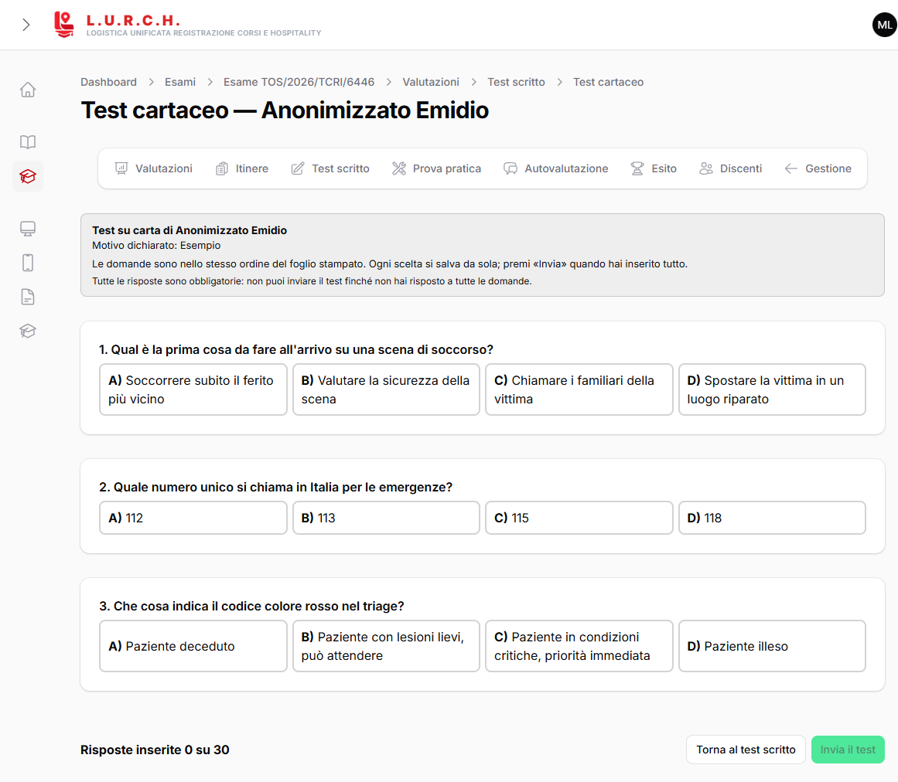
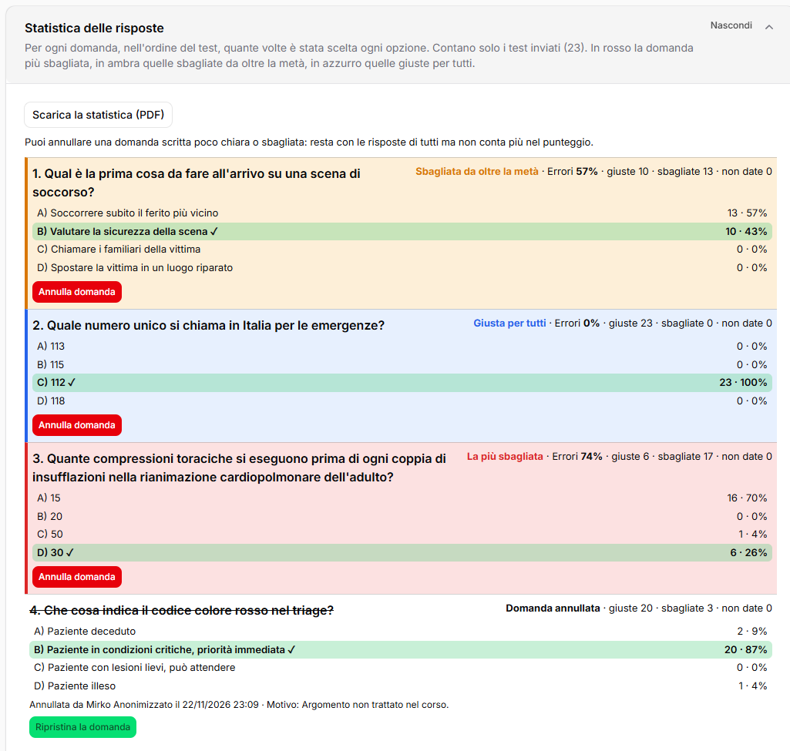
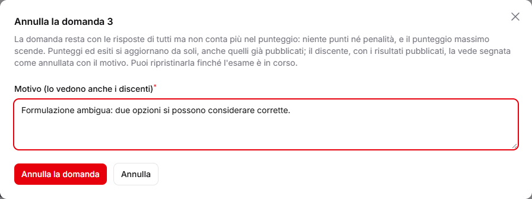

# Test scritto

> **A chi serve:** direttori dei corsi, commissioni e amministratori.

Da **Valutazioni → Test scritto** il direttore avvia il test ai discenti, segue chi lo svolge, inserisce i test su carta, guarda la statistica delle risposte, annulla le domande sbagliate o poco chiare e pubblica i risultati. Le domande e il punteggio si preparano prima, in [Domande del test](../02-preparazione/06-domande-del-test.md); il pulsante **Domande e punteggio** porta lì.

La pagina la vedono chi gestisce l'esame e la commissione. **Avviare, disattivare e gestire il test su carta spetta solo al direttore**, a esame in corso; per gli altri la pagina è in sola lettura, tranne la pubblicazione dei risultati (vedi sotto).

<!-- screenshot: route=/admin/esami/1/valutazioni/test-scritto · v1.86.3-dev · 2026-11-22 · come direttore del corso, statistica chiusa -->

## Lo stato del test

Il riquadro in alto dice in che stato è il test:

- **In bozza**: nessun discente lo vede; domande e punteggio si modificano liberamente;
- **Avviato**: almeno un discente lo vede. Domande e punteggio sono congelati, si correggono solo i refusi;
- **Con test inviati**: almeno un discente l'ha inviato.

**Riporta il test in bozza** (solo il direttore) lo disattiva a tutti e riapre la modifica di domande e punteggio. È possibile solo finché nessuno ha inviato. Le risposte già salvate restano in attesa e vengono cancellate solo se si cambiano le domande.

## Avviare il test

Nel riquadro **Svolgimento** compaiono solo i discenti ammessi: ritirati e non ammessi no. L'avvio è **per discente**:

- **Avvia per tutti** avvia il test a tutti gli ammessi; chi è già avviato o ha già inviato non cambia;
- **Avvia per i selezionati** lo avvia solo ai discenti spuntati, per esempio per una seconda data;
- **Avvia**, sulla riga, lo avvia a quel discente.

Da quel momento il discente trova il test nell'app ([Il test per il discente](03-il-test-per-il-discente.md)). Ogni avvio chiede conferma.

Ogni riga mostra lo stato del discente: **Non avviato**, **Avviato**, **In compilazione** (con quante risposte ha già salvato), **Inviato** (con il punteggio) oppure **Disattivato**.

**Disattiva**, sulla riga di un discente avviato, gli toglie il test finché non lo ha inviato. Le risposte già salvate restano: se lo riavvii senza cambiare le domande, il discente le ritrova. Un modulo che avesse già aperto non può più inviare.

## Test su carta (BES/DSA)

Per chi ha bisogno di svolgere il test su carta (per esempio per BES/DSA):

1. **Scarica il PDF da stampare**: il test di quel discente, nell'ordine originale delle domande e **senza le risposte corrette**. Lo possono scaricare tutti quelli che gestiscono l'esame.
2. **Fa il test su carta…**: il direttore indica il **motivo**, obbligatorio. Il discente non vedrà il test nell'app.

<!-- screenshot: route=/admin/esami/1/valutazioni/test-scritto · v1.86.2 · 2026-11-19 · finestra «Test su carta» -->

3. Svolto il test, **Inserisci il test cartaceo** apre la pagina dove il direttore riporta le risposte del foglio: le domande sono nello stesso ordine del foglio stampato, ogni scelta si salva da sola e alla fine si preme **Invia il test**. Con le risposte obbligatorie (senza penalità) l'invio è possibile solo quando sono tutte inserite.

<!-- screenshot: route=/admin/esami/1/valutazioni/test-scritto/11014/cartaceo · v1.86.2 · 2026-11-19 · domande sostituite a video con domande d'esempio; barra di fondo spostata sotto la terza domanda -->

Il motivo resta scritto sulla riga del discente, insieme a chi ha inserito le risposte e quando.

## Statistica delle risposte

La sezione **Statistica delle risposte** è **chiusa di default**: si apre con un clic, così aggiornando la pagina durante il test le risposte corrette non restano in vista. La vedono tutti quelli che leggono la pagina.

Per ogni domanda, nell'ordine del test, mostra le quattro opzioni con la corretta in verde e, accanto a ciascuna, quante volte è stata scelta. Sotto il testo ci sono la percentuale di errore e i numeri di risposte giuste, sbagliate e non date. Contano solo i test **inviati**, online e su carta. Tre evidenze, con una scritta accanto ai numeri, aiutano a trovare le domande difficili o scritte poco chiare:

- **La più sbagliata**, in rosso: la domanda con più risposte non corrette (se sono più d'una a pari merito, tutte);
- **Sbagliata da oltre la metà**, in ambra: più della metà dei discenti non ha dato la risposta corretta (la metà esatta non è evidenziata);
- **Giusta per tutti**, in azzurro: tutti hanno dato la risposta corretta (il verde resta per la risposta corretta di ogni domanda).

Le domande annullate non hanno evidenze e non contano nel confronto.

**Scarica la statistica (PDF)**, in cima alla sezione, scarica la stessa statistica che vede il direttore, con le evidenze e le domande annullate (chi, quando, motivo), per condividerla con i docenti. Non contiene nomi di discenti, ma contiene le **risposte corrette**: non va dato ai discenti. Lo scarica chi vede la pagina, anche a esame chiuso.

<!-- screenshot: route=/admin/esami/1/valutazioni/test-scritto · v1.86.3-dev · 2026-11-22 · come direttore, statistica aperta sulle prime 4 domande; domande sostituite a video con domande d'esempio -->

## Annullare una domanda

Se una domanda è sbagliata o poco chiara, il direttore la può **annullare** con **Annulla domanda**, sotto la domanda nella statistica:

- si può solo quando **tutti i discenti ammessi hanno inviato il test**, cartacei compresi, e con l'esame in corso; finché manca qualcuno il pulsante è spento e dice quanti test mancano;
- il **motivo** è obbligatorio e lo vedono anche i discenti;
- la domanda resta, con le risposte di tutti, ma **non conta più nel punteggio**: niente punti né penalità, e il punteggio massimo scende (per esempio da 30 a 29). Punteggi ed esiti si aggiornano da soli, anche quelli già pubblicati;
- nella statistica, in **Vedi risposte** e nell'app della commissione la domanda compare come **Domanda annullata**, con chi l'ha annullata, quando e perché; il discente la vede annullata, con il motivo, solo quando gli vengono pubblicati i risultati;
- **Ripristina la domanda** la fa tornare nel calcolo, alle stesse condizioni. Non si può annullare l'ultima domanda valida del test.

<!-- screenshot: route=/admin/esami/1/valutazioni/test-scritto · v1.86.3-dev · 2026-11-22 · come direttore, finestra «Annulla la domanda» con un motivo d'esempio -->

## Risultati e pubblicazione ai discenti

Per chi ha inviato, la riga mostra il punteggio e **Vedi risposte**, che elenca risposta per risposta quella data, se è giusta e qual era quella corretta (le domande annullate sono segnate come tali).

Dopo l'invio il discente rivede le proprie risposte, ma **non il punteggio né le correzioni**, finché non gli vengono pubblicati. Il riquadro **Risultati ai discenti** dice a quanti sono stati pubblicati:

- **Pubblica per tutti**, **Pubblica per i selezionati** e, sulla riga, **Pubblica i risultati**: il discente vede nell'app il punteggio, le domande sbagliate e le risposte corrette;
- **Ritira per tutti** e, sulla riga, **Ritira i risultati**: il discente torna a vedere solo le proprie risposte.

> Chi vede le correzioni può passarle a chi deve ancora svolgere il test: pubblica i risultati quando tutti hanno finito, oppure tienine conto se c'è una seconda data.

Pubblicano e ritirano il direttore, gli amministratori del territorio e il superadmin, anche dopo la chiusura dell'esame: la pubblicazione riguarda cosa vede il discente, non i punteggi.
