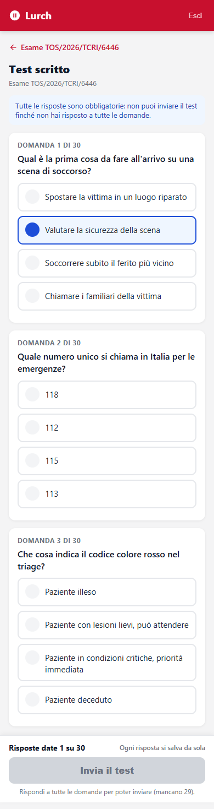
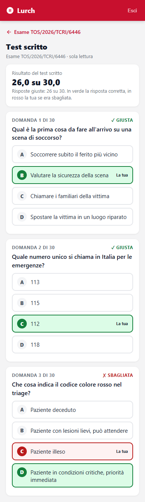

# Il test per il discente

> **A chi serve:** discenti; ai direttori, per sapere cosa vede il discente.

Il test scritto si svolge dal telefono, nell'[app dei soci](../../02-app-soci/README.md). Compare solo quando il direttore lo avvia per te: nella home trovi la sezione **Esami** con **I tuoi esami**, e nella pagina dell'esame il pulsante **Test scritto** ([L'esame nell'app](../01-come-funziona/04-l-esame-nell-app.md)).

## Svolgere il test

<!-- screenshot: route=/app/esami/1/test · v1.86.2 · 2026-11-19 · larghezza telefono; domande d'esempio, una risposta scelta a video, barra di fondo spostata sotto la terza domanda -->

- Ogni domanda ha 4 risposte: si tocca quella scelta, che si colora di blu. Si può cambiare idea toccandone un'altra.
- **Ogni risposta si salva da sola**: se la connessione cade, la pagina lo segnala sulla risposta non salvata. Si può chiudere l'app e riprendere più tardi.
- Se il direttore ha scelto l'**ordine mescolato**, domande e risposte compaiono in ordine casuale e senza lettere: a ogni apertura l'ordine cambia, le risposte date restano.
- In fondo la barra conta le **risposte date**. Senza penalità tutte le risposte sono obbligatorie e **Invia il test** si accende solo quando sono complete. Con le penalità si possono lasciare domande senza risposta: la pagina lo dice in alto.

**Invia il test** chiede conferma: dopo l'invio le risposte non si possono più cambiare e il test non si può rifare.

## Dopo l'invio

Il test resta nell'app **in sola lettura**: le domande nell'ordine originale, con le lettere, e la risposta data per ognuna. Il punteggio e le correzioni non compaiono finché il direttore non li pubblica; nella pagina dell'esame il pulsante **Test scritto** dice **Inviato**.

Se il test è stato svolto **su carta**, la pagina lo dice: le risposte sono quelle inserite dal direttore, e un errore di trascrizione va segnalato a lui.

## La correzione

Quando il direttore pubblica i risultati, il pulsante diventa **Correzione disponibile** e la pagina mostra il punteggio e, per ogni domanda, **Giusta** o **Sbagliata**: in verde la risposta corretta, in rosso la propria se era sbagliata. Una domanda **annullata** dal direttore è barrata, con il motivo, e non conta nel punteggio.

<!-- screenshot: route=/app/esami/1/test · v1.86.2 · 2026-11-19 · larghezza telefono, risultati pubblicati; domande d'esempio -->

L'**esito finale** dell'esame, con tutte le prove, è un'altra pubblicazione: [Esito e pubblicazione](05-esito-e-pubblicazione.md).
