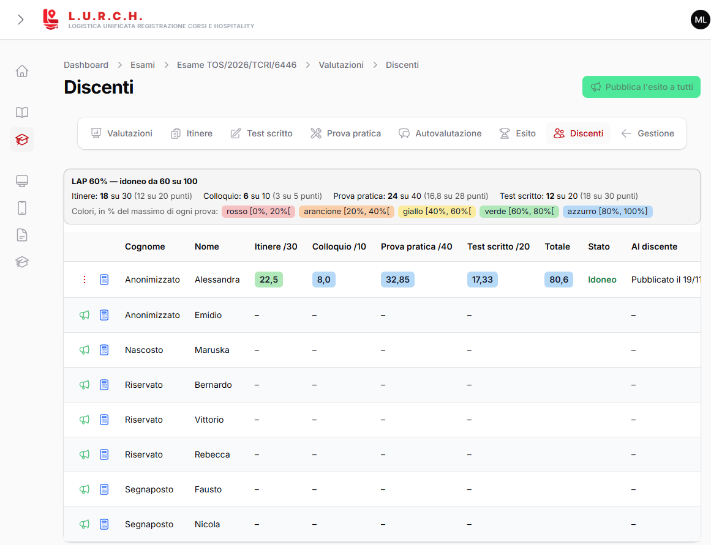
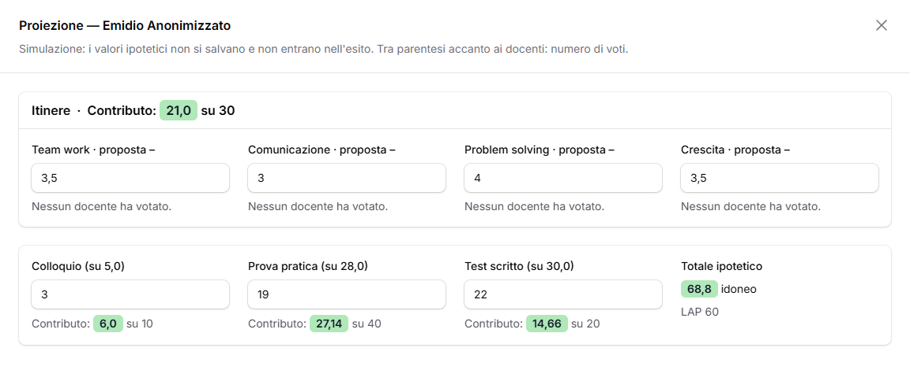

# Riepilogo dei discenti

> **A chi serve:** direttori dei corsi e amministratori.

**Valutazioni → Discenti**, l'ultima pagina della barra, mostra in una tabella a che punto è ogni discente: quanto vale già ogni prova e, quando sono tutte fissate, il totale e l'idoneità. La vede chi gestisce l'esame (direttore, amministratori del territorio, superadmin).

<!-- screenshot: route=/admin/esami/1/valutazioni/discenti · v1.86.2 · 2026-11-19 · come direttore; l'unico discente completo spostato a video in cima alla tabella -->

## La legenda in alto

Il riquadro in cima traduce il **LAP** in ogni prova: per esempio con LAP 60, idoneo da 60 su 100; l'itinere vale 18 su 30, cioè 12 su 20 punti. Sotto ci sono le **fasce dei colori**, in percentuale del massimo di ogni prova: `[40%, 60%[` vuol dire da 40% incluso a 60% escluso. Gli stessi colori si usano nelle celle della tabella.

## Le colonne

| Colonna | Cosa mostra |
|---|---|
| **Itinere /30** | Quanto vale l'itinere su 30: con i punteggi d'area fissati dal direttore oppure, dove mancano, la media dei docenti (una stima). «–» se un'area non ha né punteggio né voti |
| **Colloquio /10**, **Prova pratica /40**, **Test scritto /20** | Il contributo della prova, solo quando il suo punteggio è fissato; «–» altrimenti |
| **Totale**, **Stato** | Il punteggio finale e Idoneo / Non idoneo, solo quando tutte e quattro le prove hanno il punteggio fissato |
| **Al discente** | Se e quando l'esito è stato pubblicato al discente |

I pesi dopo la barra (30, 10, 40, 20) sono quelli del modello TCRI ([Calcolo e pesi](../04-modello-tcri/01-calcolo-e-pesi.md)).

All'inizio di ogni riga ci sono le icone per pubblicare l'esito (vedi [Esito e pubblicazione](05-esito-e-pubblicazione.md)) e la **calcolatrice** della proiezione.

## La proiezione

La **calcolatrice** apre la proiezione del discente: serve a capire dove può arrivare il punteggio finale prima che tutte le prove siano fissate. Per un discente non ammesso è spenta.

<!-- screenshot: route=/admin/esami/1/valutazioni/discenti · v1.86.2 · 2026-11-19 · proiezione di un discente senza punteggi, con valori ipotetici scritti per l'esempio -->

- Per ogni **area dell'itinere**: il punteggio fissato, oppure un campo già riempito con la media proposta dai docenti («–» se nessuno ha votato), con sotto la media di ciascun docente e tra parentesi quanti voti ha dato.
- Per **colloquio**, **prova pratica** e **test scritto**: il punteggio fissato, oppure un campo da riempire con un valore realistico.
- Ogni prova mostra quanto vale in centesimi; in fondo c'è il **totale ipotetico**, colorato rispetto al LAP, con idoneo o non idoneo.

I valori scritti sono solo una **simulazione**: non si salvano, spariscono chiudendo la finestra e non entrano nell'esito.
