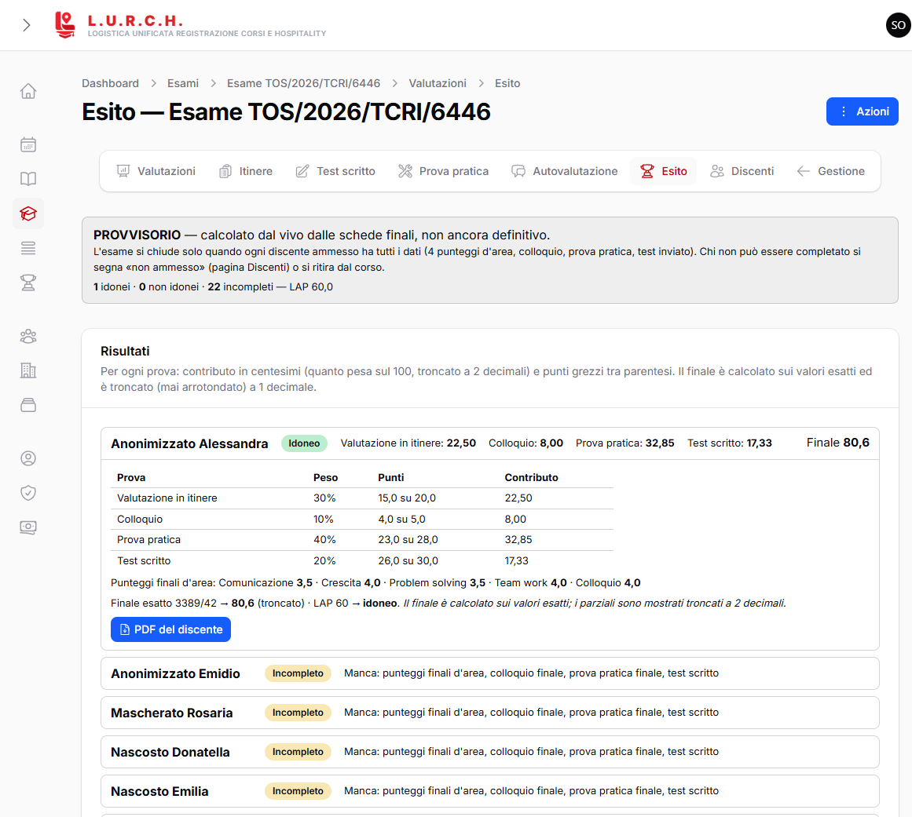
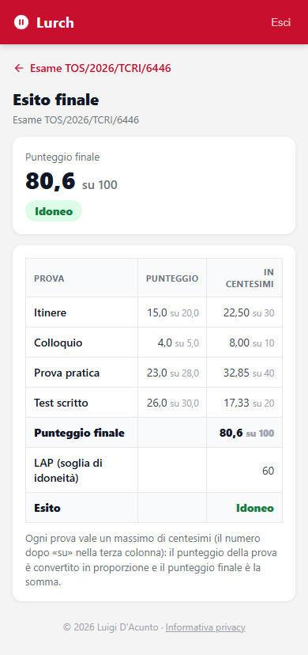

# Esito e pubblicazione

> **A chi serve:** direttori dei corsi, commissioni e amministratori; ai discenti, per sapere cosa vedranno.

## La pagina Esito

**Valutazioni → Esito** mostra il risultato di ogni discente, calcolato dalle schede finali e dal test scritto. La vedono chi gestisce l'esame e la commissione.

<!-- screenshot: route=/admin/esami/1/valutazioni/esito · v1.86.2 · 2026-11-19 · come amministratore regionale; il discente completo spostato a video in cima e la sua riga aperta -->

Finché l'esame non è chiuso il riquadro in alto dice **PROVVISORIO**: i risultati sono calcolati dal vivo e cambiano se cambia una scheda finale. Sotto c'è il conteggio di idonei, non idonei, incompleti e non ammessi, con il LAP.

Ogni discente ha una riga con un'etichetta:

- **Idoneo** o **Non idoneo**: con il contributo in centesimi di ogni prova e il **finale**;
- **Incompleto**: con l'elenco di quello che manca (punteggi finali d'area, colloquio, prova pratica, test scritto);
- **Non ammesso**: con il motivo, visibile solo qui nel pannello.

Cliccando sulla riga si apre il dettaglio: per ogni prova il peso, i punti sul massimo e il contributo; i punteggi finali d'area; il **finale esatto** e quello troncato, confrontato con il LAP. Il finale si calcola sui valori esatti e si **tronca** (non si arrotonda) a un decimale: 59,96 diventa 59,9, non idoneo con LAP 60. Le regole del calcolo sono nel capitolo del modello ([Calcolo e pesi](../04-modello-tcri/01-calcolo-e-pesi.md)).

**PDF del discente**, nel dettaglio, scarica il foglio dell'esito di quel discente ([Chiusura, riapertura ed export](06-chiusura-riapertura-export.md#esportare-pdf-e-csv)).

## Pubblicare l'esito al discente

Il discente non vede il proprio esito finché non gli viene **pubblicato**. Pubblicano il direttore, gli amministratori del territorio e il superadmin, dalla pagina [Riepilogo dei discenti](04-riepilogo-dei-discenti.md):

- l'icona a forma di **megafono** all'inizio della riga, **Pubblica l'esito**, lo pubblica a quel discente. È spenta, con il motivo, finché il discente non ha tutte e quattro le prove fissate;
- **Pubblica l'esito a tutti**, in alto, lo pubblica a tutti i discenti completi che non lo hanno ancora. Chi non è completo viene saltato: ripetendo più avanti si pubblica a chi si è completato nel frattempo. Quando non resta nessuno da pubblicare il pulsante si spegne;
- dai **tre puntini rossi** di una riga già pubblicata, **Ritira l'esito**: il discente non lo vede più.

La colonna **Al discente** mostra la data di pubblicazione. Si può pubblicare anche dopo la chiusura dell'esame.

Dopo la pubblicazione il discente vede sempre i valori **attuali**: se una scheda finale cambia prima della chiusura, cambia anche ciò che vede. Dopo la chiusura vede i risultati definitivi.

## Cosa vede il discente

Nella pagina del suo esame, nell'app, compare **Esito finale** ([L'esame nell'app](../01-come-funziona/04-l-esame-nell-app.md)). Si apre una griglia con, per ogni prova, il punteggio sul suo massimo e la conversione in centesimi sul suo peso; poi il punteggio finale su 100, il LAP dell'esame e l'esito, **Idoneo** o **Non idoneo**.

<!-- screenshot: route=/app/esami/1/esito · v1.86.2 · 2026-11-19 · larghezza telefono, esito pubblicato -->

