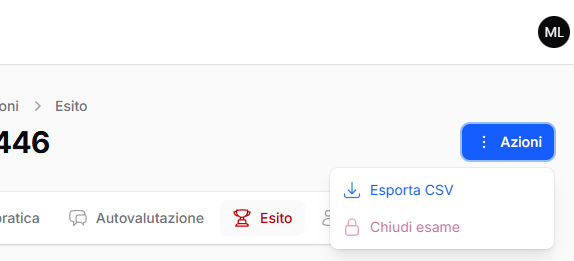

# Chiusura, riapertura ed export

> **A chi serve:** direttori dei corsi e amministratori.

## Chiudere l'esame

La chiusura rende definitivi i risultati. Si fa dalla pagina **Valutazioni → Esito**, menu **Azioni → Chiudi esame**.

<!-- screenshot: route=/admin/esami/1/valutazioni/esito · v1.86.2 · 2026-11-19 · menu Azioni, «Chiudi esame» spento -->

- Chiude **solo il direttore del corso**, a esame in corso: nemmeno gli amministratori o il superadmin. Se il direttore non ha un utente del pannello collegato al suo socio, il motivo lo dice: lo collega un amministratore da Utenti.
- Si chiude solo quando **ogni discente ammesso ha tutti i dati**: i punteggi di tutte le aree dell'itinere, il colloquio, la prova pratica e il test inviato. Altrimenti la voce è spenta e, passando il mouse, dice per quanti discenti mancano dati (sono le righe «Incompleto»).
- Chi non si può completare (per esempio un assente al test senza seconda data) va segnato **non ammesso** ([Discenti](../02-preparazione/03-discenti.md)) o ritirato dal corso.

**Chiudi esame** chiede conferma con il riepilogo: quanti idonei, non idonei e non ammessi (i ritirati non compaiono). Si conferma con **Chiudi definitivamente**.

Dopo la chiusura:

- i risultati di ogni discente sono salvati come **fotografia**: non si ricalcolano più, nemmeno se cambiassero il modello o il LAP;
- nessuno può modificare schede, test, configurazione o non ammissioni: tutto l'esame è in sola lettura, nel pannello e nell'app;
- restano possibili la consultazione, gli export e la pubblicazione di risultati ed esiti ai discenti;
- il riquadro della pagina Esito dice chi ha chiuso l'esame, quando, e fino a che giorno si può riaprire.

## Riaprire l'esame

Un esame chiuso si riapre solo dal **superadmin**, da **Azioni → Riapri esame** nella pagina Esito, entro **15 giorni di calendario** dalla chiusura (fino alla fine del quindicesimo giorno). Serve un **motivo della riapertura**, da 10 a 1000 caratteri.

La riapertura riporta l'esame in corso e **cancella i risultati salvati**: alla nuova chiusura se ne salvano di nuovi, e i 15 giorni ripartono. Del motivo resta registrata solo l'ultima riapertura, mostrata nella pagina Esito. Passati i 15 giorni l'esame non si riapre più, per nessuno.

Per chiedere una riapertura (per esempio per un voto sbagliato) si contatta il superadmin entro quel termine.

## Esportare PDF e CSV

- **PDF del discente**, nel dettaglio di ogni riga della pagina Esito: il foglio dell'esito di un discente, con i punti e il contributo di ogni prova, il finale e l'esito.
- **Esporta CSV**, nel menu **Azioni** della pagina Esito: un file con una riga per discente, apribile con un foglio di calcolo. Contiene cognome, nome, codice fiscale, stato, per ogni prova punti, massimo e contributo, punteggio finale, esito, note (cosa manca a un incompleto), LAP, versione del modello, stato e titolo dell'esame, data di chiusura.

Finché l'esame non è chiuso, PDF e CSV portano la dicitura **PROVVISORIO**; dopo la chiusura riportano i risultati definitivi.

Negli export ci sono solo nome, cognome e codice fiscale del discente: mai email, data di nascita, motivi di non ammissione, motivazioni o impressioni dei docenti.

> I file scaricati contengono dati personali (il codice fiscale): conservali solo per il tempo necessario e non diffonderli.

L'ufficialità dell'esame resta su GAIA e sulla scheda cartacea firmata dalla commissione: PDF e CSV servono come supporto.
