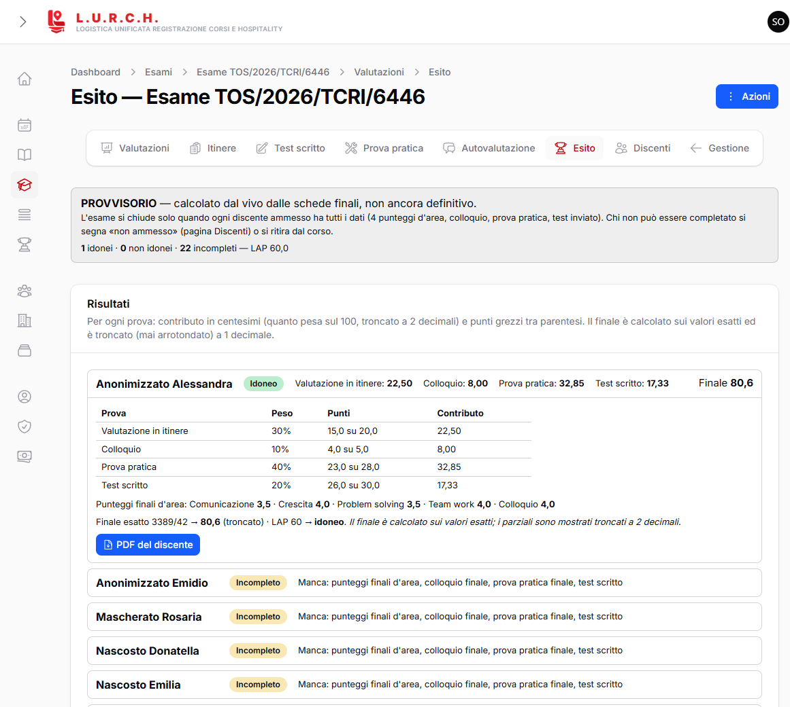

# Calcolo e pesi

> **A chi serve:** direttore e commissione.

## Pesi e massimi

Ogni prova parte dal suo punteggio, lo confronta con il suo massimo e lo converte in centesimi secondo il suo peso:

| Prova | Punteggio | Massimo | Peso |
|---|---|---|---|
| Itinere | Somma dei punteggi finali delle 4 aree, ognuno da 1 a 5 con un decimale | 20 | 30 |
| Colloquio | Voto finale da 1 a 5, con un decimale | 5 | 10 |
| Prova pratica | Totale della scheda finale a semaforo: 28 voci, rosso 0, giallo 0,25, verde 1 | 28 | 40 |
| Test scritto | Punti del test | Dipende dalle domande e dal punteggio impostato ([Domande del test](../02-preparazione/06-domande-del-test.md)) | 20 |

Il **contributo** di una prova è il punteggio diviso per il massimo, moltiplicato per il peso. Il **punteggio finale** è la somma dei quattro contributi, su 100.

## Un esempio

<!-- screenshot: route=/admin/esami/1/valutazioni/esito · v1.86.2 · 2026-11-19 · come amministratore regionale; il discente completo spostato a video in cima e la sua riga aperta -->

| Prova | Punteggio | Contributo |
|---|---|---|
| Itinere | 15,0 su 20 | 15 ÷ 20 × 30 = 22,50 |
| Colloquio | 4,0 su 5 | 4 ÷ 5 × 10 = 8,00 |
| Prova pratica | 23,0 su 28 | 23 ÷ 28 × 40 = 32,857… → mostrato 32,85 |
| Test scritto | 26 su 30 | 26 ÷ 30 × 20 = 17,333… → mostrato 17,33 |

La somma esatta è 80,690…: il finale è **80,6**, idoneo con LAP 60.

## Troncamento e LAP

- I contributi si mostrano **troncati a 2 decimali**, ma il finale si calcola sui valori esatti, non sui numeri mostrati.
- Il finale si **tronca a un decimale**, mai arrotondato: 59,96 diventa 59,9.
- Il discente è **idoneo** se il finale troncato è uguale o superiore al **LAP** dell'esame. Con LAP 60, 59,9 è non idoneo.

Il LAP si imposta per ogni esame ([Creare l'esame](../02-preparazione/01-creare-l-esame.md)). Il riquadro in cima a [Riepilogo dei discenti](../03-svolgimento-e-chiusura/04-riepilogo-dei-discenti.md) traduce il LAP nei punti di ogni prova e mostra le fasce dei colori usate in tutte le schede.

## Quando manca un dato

Il calcolo non usa mai valori parziali né zeri inventati. Se manca anche solo il punteggio finale di un'area, il colloquio, la scheda finale della prova pratica o il test inviato, il discente non ha finale né esito: è **Incompleto** e l'elenco dice cosa manca ([Esito e pubblicazione](../03-svolgimento-e-chiusura/05-esito-e-pubblicazione.md)).

## Le versioni del modello

Pesi, aree, voci, scale e testi delle schede formano una **versione** del modello; oggi c'è la versione 1. All'attivazione l'esame ne fa una copia, che non cambia più: la versione è indicata nella [Panoramica](../02-preparazione/02-panoramica-e-commissione.md).

Una modifica al modello diventa una nuova versione e vale solo per gli esami attivati dopo. Gli esami già attivati continuano con la loro copia. Dopo la chiusura i risultati sono fissati e non cambiano più, nemmeno se cambiano il modello o il LAP ([Chiusura, riapertura ed export](../03-svolgimento-e-chiusura/06-chiusura-riapertura-export.md)).
