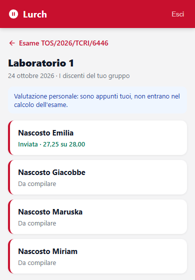
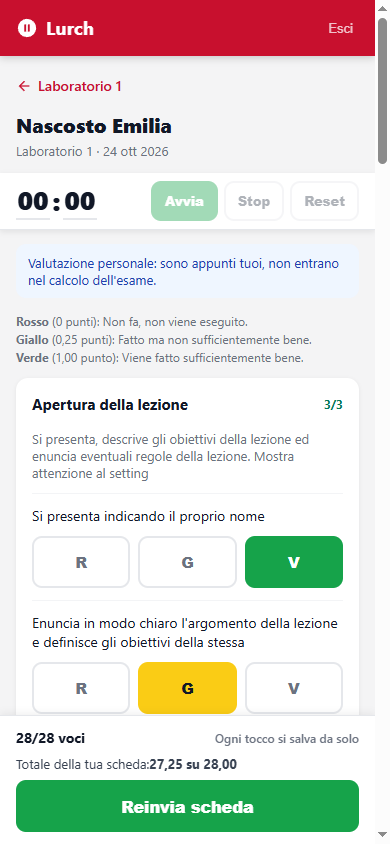
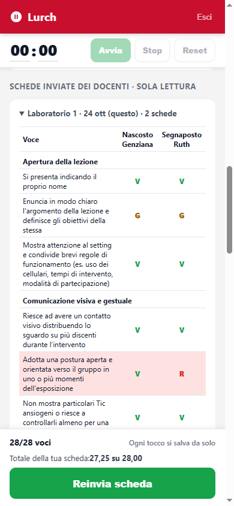
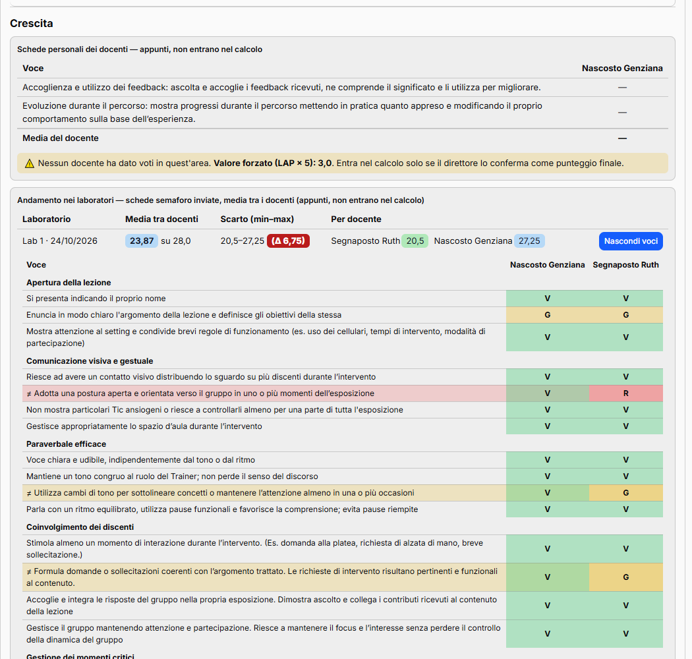

# Laboratori a semaforo

> **A chi serve:** docenti, direttore, commissione e tutor.

Nei laboratori i docenti osservano ogni discente del proprio gruppo mentre conduce un intervento formativo e lo valutano con una **scheda a semaforo**. È una scheda personale: sono appunti del docente e non entrano nel calcolo. Al direttore servono come riferimento per l'area Crescita dell'itinere ([Itinere](03-itinere.md)).

## La scheda

La scheda ha **28 voci** divise in 7 competenze: Apertura della lezione (3), Comunicazione visiva e gestuale (4), Paraverbale efficace (4), Coinvolgimento dei discenti (4), Gestione dei momenti critici (4), Contenuto aderente al mandato (7), Chiusura della lezione (2).

Ogni voce ha tre valori:

| Valore | Significato | Punti |
|---|---|---|
| **R** rosso | Non fa, non viene eseguito | 0 |
| **G** giallo | Fatto ma non sufficientemente bene | 0,25 |
| **V** verde | Viene fatto sufficientemente bene | 1 |

Il totale della scheda va da 0 a 28. La stessa scheda si usa nella [prova pratica](05-prova-pratica.md).

## Compilare la scheda nell'app

Dalla pagina dell'esame ([L'esame nell'app](../01-come-funziona/04-l-esame-nell-app.md)) si apre il laboratorio: compaiono solo i discenti dei propri gruppi in quel laboratorio. Per ognuno lo stato: **Da compilare**, **Bozza** con le voci già scelte, oppure **Inviata** con il totale.

<!-- screenshot: route=/app/esami/1/laboratori/1 · v1.86.2 · 2026-11-19 · larghezza telefono, docente di prova -->

Se l'elenco è vuoto, il docente non è in nessun gruppo di quel laboratorio: lo inserisce il direttore ([Laboratori e gruppi](../02-preparazione/04-laboratori-e-gruppi.md)).

<!-- screenshot: route=/app/esami/1/laboratori/1/discenti/9226 · v1.86.2 · 2026-11-19 · larghezza telefono, scheda inviata -->

- In alto c'è un **timer** per cronometrare l'intervento: si impostano minuti e secondi, poi **Avvia**, **Stop** e **Reset**. Il conteggio prosegue anche ricaricando la pagina; allo scadere il timer diventa rosso e il telefono vibra o suona, dove il dispositivo lo consente.
- Le competenze si aprono e si chiudono; accanto al nome, quante voci sono già scelte. All'apertura è aperta la prima competenza incompleta.
- Ogni tocco su **R**, **G** o **V** si salva da solo. La barra in fondo mostra le voci scelte e il totale.
- **Invia scheda** si attiva quando tutte le 28 voci sono scelte. Anche dopo l'invio la scheda resta modificabile, finché l'esame è in corso: il pulsante diventa **Reinvia scheda**.
- Sotto la scheda c'è un'**annotazione** libera, fino a 1000 caratteri. La leggono il direttore e, a scheda inviata, i tutor del discente e gli altri docenti nel confronto.
- **Il tuo andamento** riporta le proprie schede dello stesso discente in tutti i laboratori, con il totale.

A esame chiuso la scheda si può solo consultare.

## Il confronto tra docenti

Dopo aver inviato la propria scheda, in fondo alla pagina compaiono in sola lettura le **schede inviate dagli altri docenti** per lo stesso discente: prima il laboratorio corrente, poi gli altri laboratori in cui il discente ha almeno una scheda inviata. Le bozze non si vedono mai.

<!-- screenshot: route=/app/esami/1/laboratori/1/discenti/9226 · v1.86.2 · 2026-11-19 · larghezza telefono, pagina scorsa fino al confronto -->

Ogni colonna è un docente. Lo sfondo **giallo** indica una voce con risposte diverse, lo sfondo **rosso** una voce in cui un docente ha dato rosso e un altro verde. L'ultima riga riporta il totale di ogni scheda; la nota di un docente si apre con la «i» accanto al suo nome.

## Nel pannello

L'andamento dei laboratori si legge nella pagina **Valutazioni → Itinere**, la stessa del punteggio finale delle aree ([Itinere](03-itinere.md)). La vedono il direttore, la commissione e gli amministratori.

- Nel titolo di ogni discente, per i laboratori già svolti: **Lab N inviate/attese**, in verde quando tutti i docenti attesi hanno inviato. Se la differenza tra i totali dei docenti supera il 15% del massimo (4,2 punti su 28), compare in rosso **Δ Lab N** con lo scarto.
- Aprendo il discente, l'area **Crescita** ha la tabella **Andamento nei laboratori**: per ogni laboratorio la media tra i docenti, lo scarto (minimo–massimo) e il totale di ciascun docente, colorati rispetto al LAP. **Vedi voci** apre la tabella voce per voce.

<!-- screenshot: route=/admin/esami/1/valutazioni/itinere · v1.86.2 · 2026-11-19 · come direttore, area Crescita di un discente con «Vedi voci» aperto -->

Contano solo le schede inviate. I colori seguono le fasce del LAP descritte in [Riepilogo dei discenti](../03-svolgimento-e-chiusura/04-riepilogo-dei-discenti.md). Le note dei docenti nel pannello le apre solo il direttore, con la «i» accanto al nome.
