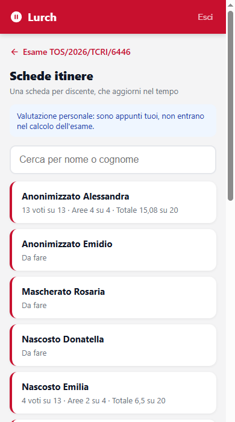
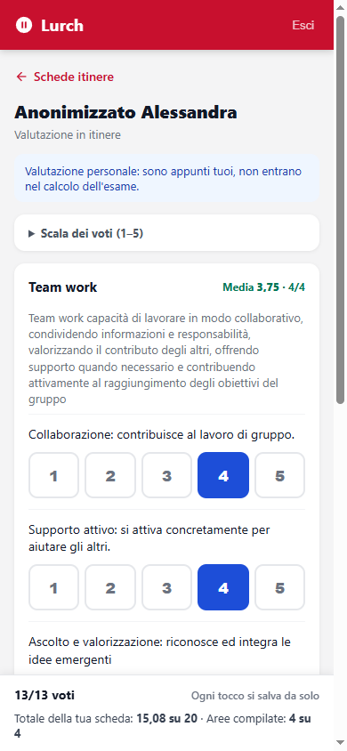
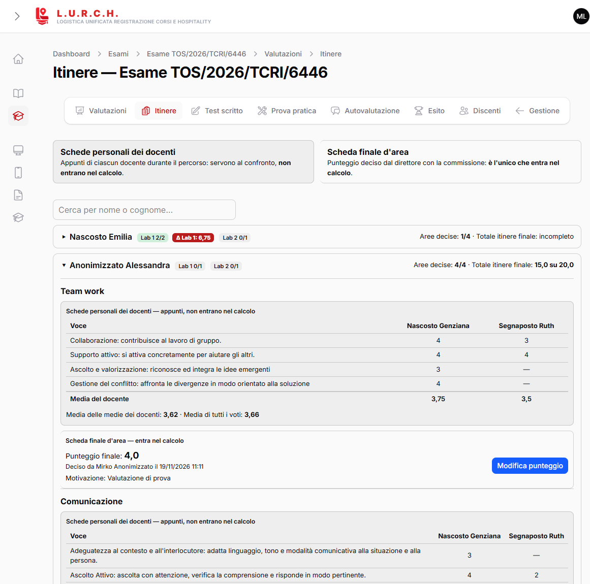
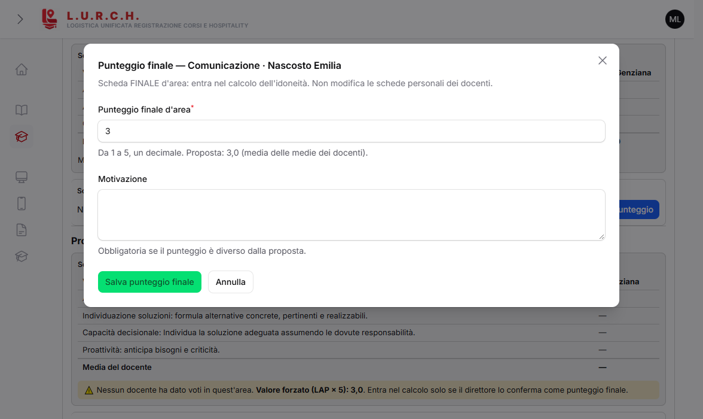
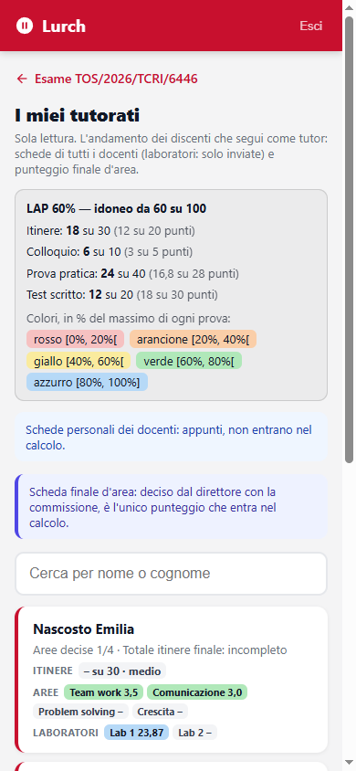
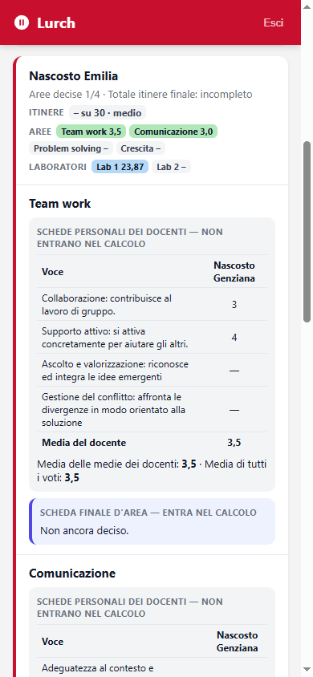

# Itinere

> **A chi serve:** docenti, direttore, commissione e tutor.

La valutazione in itinere accompagna tutto il corso. Ogni docente, compreso il direttore, tiene una **scheda personale** per ogni discente e la aggiorna nel tempo. Alla fine il direttore, con la commissione, fissa il **punteggio finale** di ciascuna delle quattro aree: sono questi punteggi, non le schede, a entrare nel calcolo, con peso 30 ([Calcolo e pesi](01-calcolo-e-pesi.md)).

## Aree e scala

La scheda ha **13 voci** in 4 aree: **Team work** (4), **Comunicazione** (3), **Problem solving** (4), **Crescita** (2). Ogni voce si valuta da 1 a 5:

| Voto | Il comportamento… |
|---|---|
| 1 | non emerge, oppure è preponderante e incontrollato: nel complesso inefficace. Richiede un intervento strutturato |
| 2 | emerge occasionalmente o se sollecitato |
| 3 | emerge frequentemente: è la valutazione minima accettabile |
| 4 | emerge ed è adeguato |
| 5 | emerge con continuità, autonomia ed efficacia anche in situazioni impegnative |

L'area Crescita tiene conto anche dell'andamento nei laboratori e di quanto emerso nel resto del corso ([Laboratori a semaforo](02-laboratori-a-semaforo.md)).

## La scheda nell'app

Dalla pagina dell'esame, **Schede itinere** elenca tutti i discenti del corso, esclusi i ritirati, con una ricerca per nome. Per ognuno: **Da fare**, oppure quanti voti sono stati dati, quante aree hanno almeno un voto e il totale della propria scheda.

<!-- screenshot: route=/app/esami/1/itinere · v1.86.2 · 2026-11-19 · larghezza telefono, docente di prova -->

<!-- screenshot: route=/app/esami/1/itinere/discenti/5495 · v1.86.2 · 2026-11-19 · larghezza telefono, scheda completa -->

- **Scala dei voti** apre la descrizione dei cinque livelli.
- Ogni area si apre e si chiude; accanto al nome, la **media** dei propri voti in quell'area e quante voci sono votate. All'apertura è aperta la prima area senza voti.
- Ogni tocco su un numero si salva da solo. Toccando di nuovo il voto scelto lo si toglie.
- Non c'è un invio: la scheda resta modificabile finché l'esame è in corso.
- La barra in fondo mostra i voti dati, il **totale della propria scheda** su 20 (la somma delle medie d'area; un'area senza voti non conta) e le aree compilate.
- Sotto le aree c'è un'**annotazione** libera, fino a 3000 caratteri, che leggono anche il direttore e i tutor del discente.

Un discente segnato «non ammesso» resta nell'elenco: la non ammissione riguarda solo la prova finale.

## Il riepilogo nel pannello

**Valutazioni → Itinere** riunisce le schede di tutti i docenti. La vedono il direttore, il presidente o delegato, i docenti in commissione, gli amministratori del territorio e il superadmin; solo il direttore decide i punteggi.

<!-- screenshot: route=/admin/esami/1/valutazioni/itinere · v1.86.2 · 2026-11-19 · come direttore; due discenti spostati a video in cima, il primo completo aperto -->

Nel titolo di ogni discente: lo stato dei laboratori, quante aree sono decise e il **totale itinere finale**, che compare solo con tutte e quattro le aree decise. Aprendo il discente, per ogni area:

- la tabella **voce per docente**, con la media di ciascun docente. Compaiono solo i docenti che hanno compilato la scheda di quel discente;
- la **media delle medie dei docenti**, in cui ogni docente pesa uguale: è la **proposta** per il punteggio finale. Accanto, per confronto, la media di tutti i voti;
- nell'area Crescita, l'**andamento nei laboratori** ([Laboratori a semaforo](02-laboratori-a-semaforo.md#nel-pannello));
- la **scheda finale d'area**: il punteggio, chi l'ha deciso e quando, la motivazione.

Se nessun docente ha votato un'area, la proposta è un **valore forzato** pari al LAP riportato sulla scala: con LAP 60, 3,0. È evidenziato in giallo ed entra nel calcolo solo se il direttore lo salva come punteggio finale.

Se un docente ha scritto un'annotazione sulla scheda itinere, in cima al discente compare la riga «… ha inserito una nota sulla scheda itinere»: la nota si apre con la «i» e la legge solo il direttore.

## Decidere il punteggio d'area

**Decidi punteggio**, sotto ogni area, apre la scheda finale di quell'area. Il pulsante lo vede solo il direttore ed è attivo solo a esame in corso; per un discente non ammesso è spento.

<!-- screenshot: route=/admin/esami/1/valutazioni/itinere · v1.86.2 · 2026-11-19 · come direttore, finestra «Decidi punteggio» aperta e annullata -->

- Il punteggio va da 1 a 5, con un decimale, ed è già riempito con la proposta.
- La **motivazione** è obbligatoria solo se il punteggio è diverso dalla proposta.
- Ogni area si salva da sola e si può modificare fino alla chiusura con **Modifica punteggio**: il nuovo valore sostituisce il precedente.

## Il riepilogo nell'app

Per la commissione la pagina dell'esame nell'app ha **Riepilogo itinere**: gli stessi contenuti del pannello, in sola lettura.

## I miei tutorati

Il tutor di un gruppo di tutoraggio ([Tutoraggio](../02-preparazione/05-tutoraggio.md)) trova nella pagina dell'esame **I miei tutorati**, in sola lettura. In cima c'è la legenda del LAP, poi i suoi discenti. Per ognuno, senza aprirlo:

- **Itinere**: quanto vale su 30, «finale» se il direttore ha deciso tutte le aree, altrimenti «medio» dalle medie dei docenti; «–» se manca una media;
- **Aree**: la media dei docenti in ogni area, colorata rispetto al LAP; «–» se nessuno ha ancora votato;
- **Laboratori**: la media dei docenti in ogni laboratorio.

<!-- screenshot: route=/app/esami/1/tutorati · v1.86.2 · 2026-11-19 · larghezza telefono, docente tutor di prova -->

Aprendo un discente vede le schede itinere di tutti i docenti, l'andamento nei laboratori (solo schede inviate, voce per voce), il punteggio finale delle aree e le note dei docenti sul discente.

<!-- screenshot: route=/app/esami/1/tutorati · v1.86.2 · 2026-11-19 · larghezza telefono, un discente aperto -->

Il tutor non vede prova pratica, colloquio, test scritto né esito.
