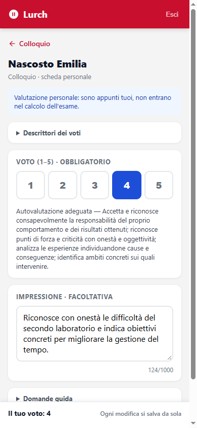
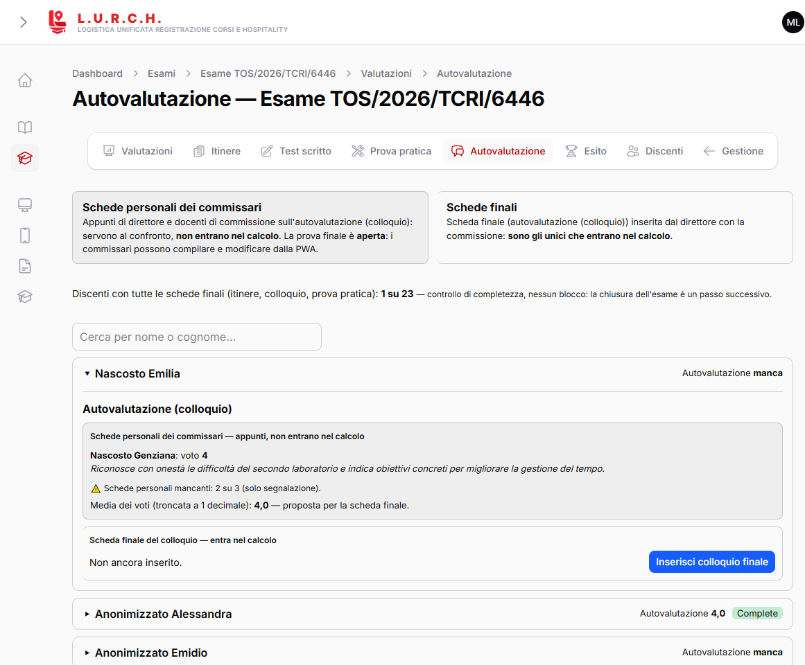
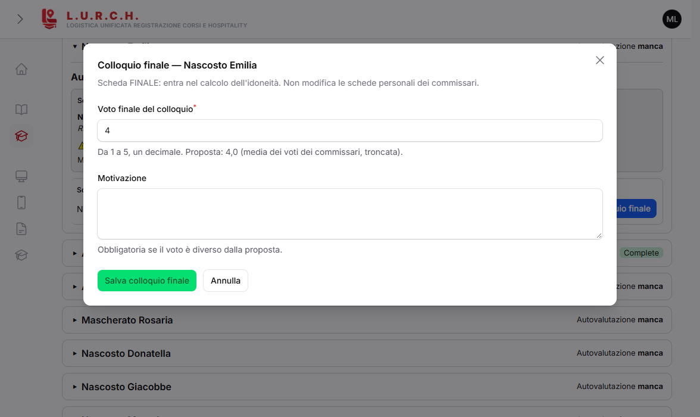

# Colloquio

> **A chi serve:** direttore e commissione.

Nel modello TCRI il colloquio è un **colloquio di autovalutazione**: il discente rilegge il proprio percorso e la commissione valuta quanto sa analizzarlo. Per questo nel pannello la pagina del colloquio si chiama **Autovalutazione**. Il voto finale, da 1 a 5, entra nel calcolo con peso 10 ([Calcolo e pesi](01-calcolo-e-pesi.md)).

## La scala

| Voto | Autovalutazione | In sintesi |
|---|---|---|
| 1 | assente | Non riconosce gli aspetti critici, si difende o attribuisce ad altri le responsabilità |
| 2 | insufficiente | Racconta la propria esperienza solo in parte, in modo confuso; consapevolezza limitata |
| 3 | accettabile | Descrive con sufficiente onestà comportamenti, punti di forza e difficoltà, senza approfondirne le cause |
| 4 | adeguata | Si assume la responsabilità dei propri risultati, ne analizza cause e conseguenze, individua cosa migliorare |
| 5 | profonda | Elabora l'esperienza in modo autonomo e critico e la trasforma in obiettivi di miglioramento |

Il testo completo di ogni livello è nella scheda. Le **domande guida** del colloquio riguardano feedback, team work, problem solving, comunicazione e performance complessiva.

## La scheda personale nell'app

La compilano il **direttore** e i **docenti in commissione**, quando la prova finale è aperta ([Ciclo di vita](../01-come-funziona/02-ciclo-di-vita.md#prova-finale-aperta-o-chiusa)); il presidente o delegato non compila. Dalla pagina dell'esame, nella sezione **Prova finale**, **Colloquio** elenca i discenti ammessi con il proprio voto oppure «Da fare».

<!-- screenshot: route=/app/esami/1/colloquio/discenti/9226 · v1.86.2 · 2026-11-19 · larghezza telefono, docente di prova in commissione, voto e impressione d'esempio -->

- **Descrittori dei voti** apre il testo dei cinque livelli; è aperto finché non si sceglie un voto.
- Il **voto**, da 1 a 5 senza decimali, è obbligatorio: si può cambiare ma non togliere. Sotto compare la descrizione del livello scelto.
- L'**impressione**, facoltativa e fino a 1000 caratteri, si scrive dopo aver scelto il voto.
- **Domande guida** apre le domande da porre al discente.
- Ogni modifica si salva da sola; non c'è un invio.

Se la prova finale viene richiusa, o l'esame non è in corso, la scheda si può solo consultare.

## La pagina Autovalutazione nel pannello

**Valutazioni → Autovalutazione** mostra, per ogni discente ammesso, le schede personali e la scheda finale. La vedono il direttore, la commissione e gli amministratori.

<!-- screenshot: route=/admin/esami/1/valutazioni/autovalutazione · v1.86.2 · 2026-11-19 · come direttore; due discenti spostati a video in cima, il primo aperto -->

- Le **schede personali dei commissari**: il voto di ciascuno e la sua impressione. Se mancano schede lo segnala, senza bloccare nulla.
- La **media dei voti**, troncata a un decimale, è la **proposta** per il voto finale.
- La **scheda finale del colloquio**: il voto, chi l'ha inserito e quando, la motivazione.

La riga in alto conta i discenti con tutte le schede finali (itinere, colloquio, prova pratica): è solo un controllo, la chiusura verifica anche il test ([Chiusura, riapertura ed export](../03-svolgimento-e-chiusura/06-chiusura-riapertura-export.md)).

## Il voto finale

**Inserisci colloquio finale** lo vede solo il direttore ed è attivo a esame in corso, anche con la prova finale chiusa.

<!-- screenshot: route=/admin/esami/1/valutazioni/autovalutazione · v1.86.2 · 2026-11-19 · come direttore, finestra «Inserisci colloquio finale» aperta e annullata -->

- Il voto va da 1 a 5, con un decimale, ed è già riempito con la proposta.
- La **motivazione** è obbligatoria solo se il voto è diverso dalla proposta.
- Si modifica fino alla chiusura con **Modifica colloquio finale**: il nuovo voto sostituisce il precedente.

Le impressioni dei commissari e le motivazioni restano nel pannello e nell'app della commissione: non le vede il discente e non compaiono nei PDF e nei CSV.
