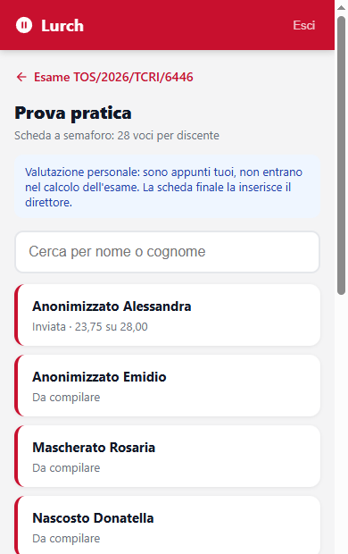
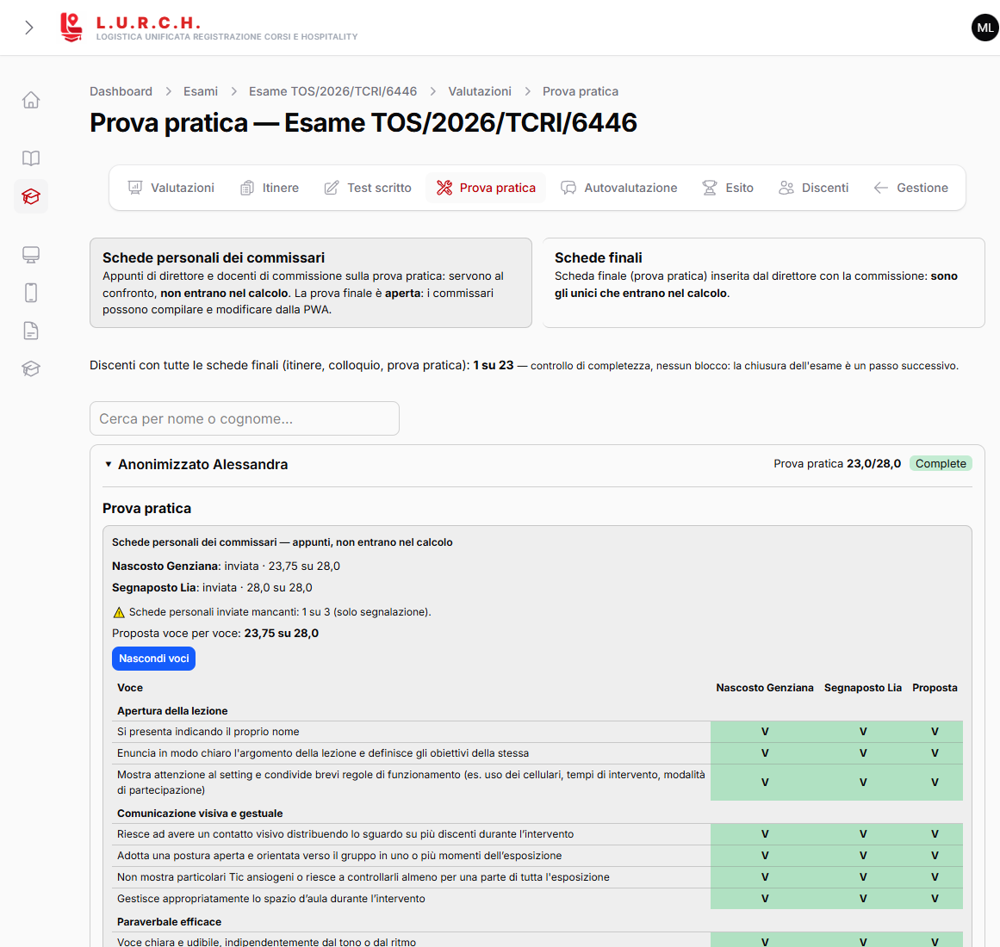
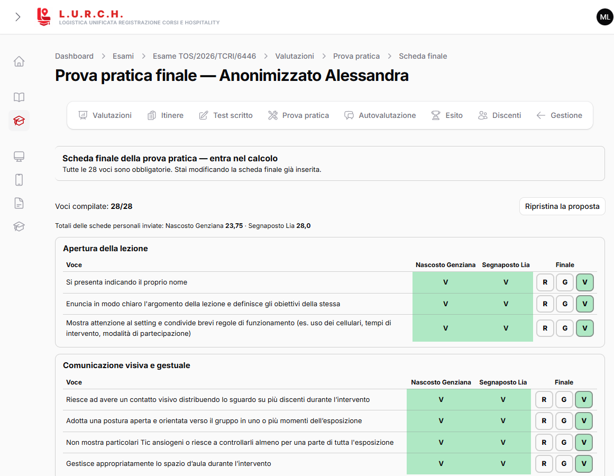

# Prova pratica

> **A chi serve:** direttore e commissione.

Nella prova pratica la commissione valuta il discente con la stessa **scheda a semaforo** dei laboratori: 28 voci, rosso 0, giallo 0,25, verde 1, totale fino a 28 ([Laboratori a semaforo](02-laboratori-a-semaforo.md#la-scheda)). La scheda finale entra nel calcolo con peso 40 ([Calcolo e pesi](01-calcolo-e-pesi.md)).

## Le schede personali nell'app

Le compilano il **direttore** e i **docenti in commissione**, quando la prova finale è aperta ([Ciclo di vita](../01-come-funziona/02-ciclo-di-vita.md#prova-finale-aperta-o-chiusa)); il presidente o delegato non compila. Dalla pagina dell'esame, nella sezione **Prova finale**, **Prova pratica** elenca tutti i discenti ammessi, senza gruppi, con lo stato della propria scheda.

<!-- screenshot: route=/app/esami/1/prova-pratica · v1.86.2 · 2026-11-19 · larghezza telefono, docente di prova in commissione -->

La scheda funziona come quella dei laboratori: timer in alto, un tocco per voce che si salva da solo, **Invia scheda** con tutte le 28 voci, modifiche possibili anche dopo l'invio. Qui non ci sono l'annotazione e il confronto con gli altri: le schede di tutti si leggono nel riepilogo. Se la prova finale viene richiusa, o l'esame non è in corso, la scheda si può solo consultare.

Nella proposta del direttore contano solo le schede **inviate**.

## La pagina Prova pratica nel pannello

**Valutazioni → Prova pratica** mostra, per ogni discente ammesso, le schede personali e la scheda finale. La vedono il direttore, la commissione e gli amministratori.

<!-- screenshot: route=/admin/esami/1/valutazioni/prova-pratica · v1.86.2 · 2026-11-19 · come direttore, primo discente aperto con «Vedi voci» -->

- Le **schede personali dei commissari**: inviata con il totale, oppure bozza con le voci scelte (una bozza non conta nella proposta). Se mancano schede inviate lo segnala, senza bloccare nulla.
- La **proposta voce per voce**: per ogni voce il valore più frequente tra le schede inviate; in caso di pareggio, il **più basso**. Nell'esempio una scheda dà 23,75 e l'altra 28,0: sulle voci in pareggio vince il valore più basso, e la proposta è 23,75.
- **Vedi voci** apre la tabella voce per commissario, con la colonna della proposta; le voci su cui i commissari non concordano hanno «≠» e lo sfondo ambra.
- La **scheda finale della prova pratica**: il totale, chi l'ha inserita e quando.

## Inserire la scheda finale

**Inserisci prova pratica finale** lo vede solo il direttore ed è attivo a esame in corso, anche con la prova finale chiusa. Apre una pagina con tutte le 28 voci.

<!-- screenshot: route=/admin/esami/1/valutazioni/prova-pratica/5495/finale · v1.86.2 · 2026-11-19 · come direttore, scheda finale già inserita; stile dei pulsanti R G V ripristinato a video -->

- Le voci sono **già scelte secondo la proposta**; accanto, le risposte di ogni commissario. Senza schede inviate si scelgono tutte a mano.
- Si cambia una voce toccando **R**, **G** o **V** nella colonna **Finale**. **Ripristina la proposta** riporta tutte le voci alla proposta.
- **Salva scheda finale** si attiva con tutte le 28 voci scelte: una scheda finale a metà non si salva. Non serve una motivazione.
- Si modifica fino alla chiusura con **Modifica prova pratica finale**; **Annulla** torna alla pagina senza salvare.

## Il riepilogo nell'app

Per la commissione la pagina dell'esame nell'app ha **Riepilogo prova finale**: le schede personali e finali di colloquio e prova pratica, in sola lettura.
